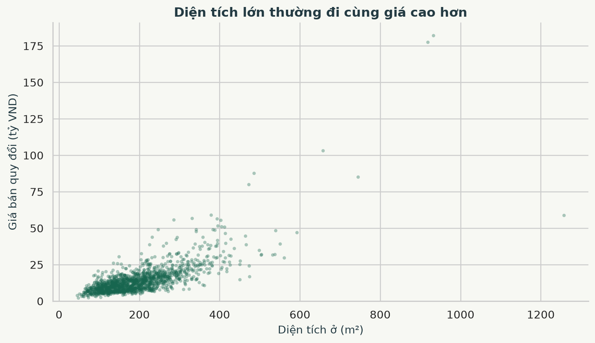
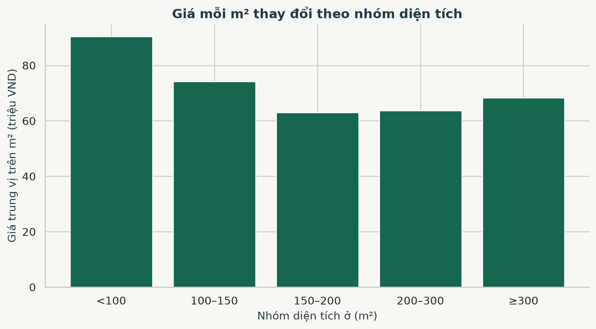
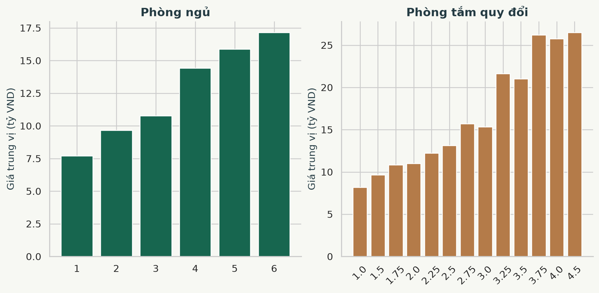
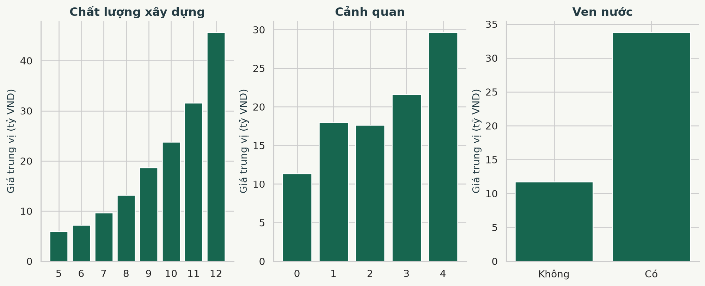
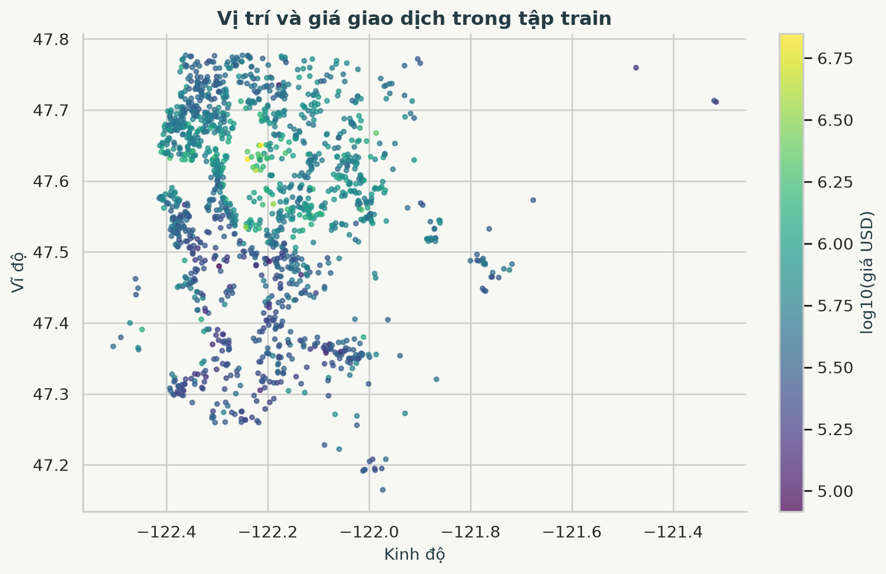
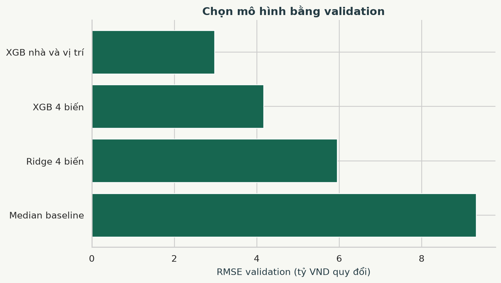
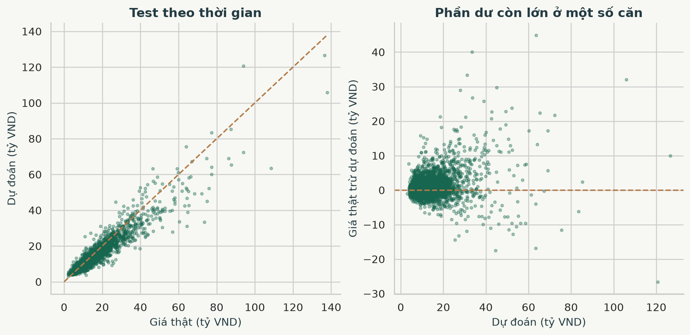
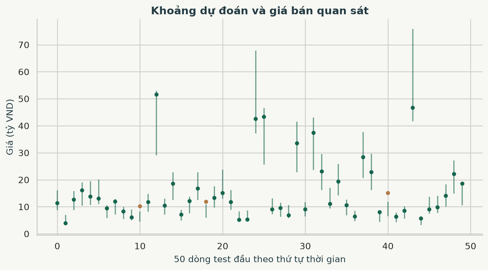
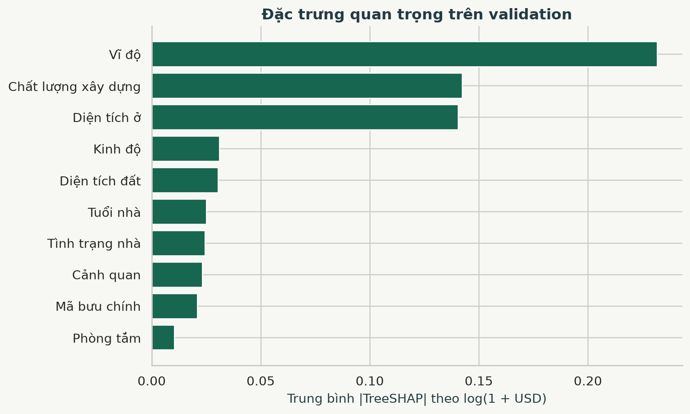
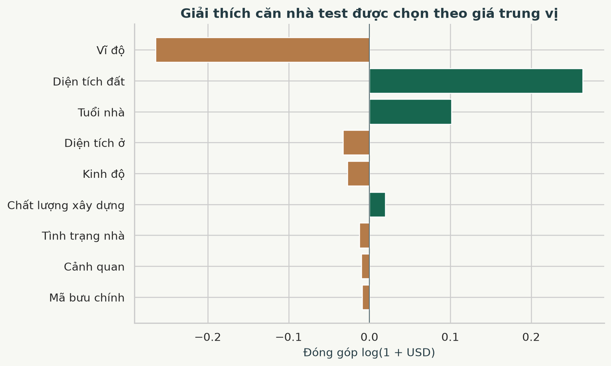

BÁO CÁO TIỂU LUẬN CUỐI KỲ

Phân tích dữ liệu và dự đoán giá nhà tại King County

Dữ liệu giao dịch nhà tại Washington Hoa Kỳ giai đoạn 2014–2015

Hiển thị kết quả bằng VND quy đổi

Sinh viên  Nguyễn Duy Trường
Mã số sinh viên  24150180
Nhóm  8
Ngày cập nhật  07 tháng 11 năm 2026

### Tóm tắt nghiên cứu

Nghiên cứu sử dụng 21.613 giao dịch King County để phân tích mối liên hệ giữa giá bán với diện tích, số phòng, chất lượng, cảnh quan và vị trí. Sau kiểm tra quy tắc, giữ lại 21.584 giao dịch. Mô hình XGBoost nhà và vị trí được chọn bằng validation theo thời gian và đạt R² 0,873 trên 4.750 giao dịch test ở kỳ sau. Tỷ lệ dự đoán sai lệch không quá ±20% là 79,5%.

Báo cáo kết nối các kết quả với ứng dụng Flask, thể hiện giá trên m², khoảng dự đoán và giải thích TreeSHAP của từng căn. Giá VND là phép đổi đơn vị từ giá nhà Mỹ lịch sử. Khoảng cách đến trường học và cửa hàng chưa có nguồn lịch sử truy xuất thành công, vì vậy chưa được sử dụng làm bằng chứng hay đặc trưng của mô hình hiện tại.

## 1 Mục tiêu và phạm vi dữ liệu

Mục tiêu là ước tính giá bán của một căn nhà trong phạm vi King County, đồng thời cung cấp căn cứ để người xem hiểu dự đoán. Một đầu ra giá đơn lẻ chưa phản ánh hết độ bất định. Vì vậy hệ thống kết hợp phân tích khám phá, đánh giá trên giao dịch mới hơn, khoảng dự đoán, đặc trưng đóng góp và các giao dịch tương đồng đã bán trước đó.

Nguồn chính là House Sales in King County, USA do tài khoản harlfoxem công bố trên Kaggle. GeoDa Center cung cấp mô tả biến và phạm vi thời gian. CSV có 21 thuộc tính, ngày bán từ 02/05/2014 đến 27/05/2015. Một dòng là một giao dịch, không nhất thiết là một căn nhà riêng biệt. [1][2]

| Nội dung | Giá trị |
|---|---|
| Đơn vị giá nguồn | USD cho từng giao dịch |
| Đơn vị diện tích nguồn | ft² |
| Chuyển đổi diện tích | 1 ft² = 0,09290304 m² |
| Phạm vi địa lý | King County, Washington, Hoa Kỳ |
| Mẫu gốc | 21.613 |
| Mẫu được chấp nhận | 21.584 |
| Mã nhà riêng biệt sau lọc | 21.407 |

Các thông tin có trong dataset không bao gồm tên cửa hàng, vị trí trường học, chất lượng trường, tội phạm hay thời gian đi lại. Tọa độ và mã bưu chính cho biết vị trí, nhưng không đủ để tự khẳng định một căn nhà gần tiện ích cụ thể. Những biến này cần một nguồn bổ sung, thời điểm phù hợp và phép đo rõ ràng.

Tỷ giá chỉ phục vụ hiển thị. Nhân nhãn và dự đoán với cùng tỷ giá sẽ đổi MAE, RMSE sang VND, trong khi R² và sai số phần trăm không đổi. Nghiên cứu không sử dụng phép quy đổi tiền tệ để khẳng định mô hình phù hợp với thị trường Việt Nam hoặc giá thị trường năm 2026.

## 2 Kiểm tra dữ liệu và lựa chọn đặc trưng

Không có bản ghi trùng hoàn toàn trong snapshot. Bộ quy tắc loại 29 dòng vi phạm miền hợp lệ như số phòng bất thường, phòng tắm không hợp lệ hoặc năm xây/cải tạo sau năm bán. Các mã bị loại được lưu trong metadata. Không tự sửa 33 phòng thành 3 phòng, không điền giá giả và không xóa mọi giao dịch lặp mã căn nhà.

| Nhóm | Đầu vào mô hình | Ý nghĩa |
|---|---|---|
| Quy mô | living_m2, lot_m2 | Diện tích ở và diện tích đất tách riêng |
| Số phòng | bedrooms, bathrooms | Phòng ngủ nguyên và phòng tắm quy đổi |
| Kết cấu | floors, grade | Số tầng và hạng chất lượng xây dựng |
| Tình trạng | condition | Điểm ghi nhận tình trạng 1–5 |
| Môi trường | waterfront, view | Ven nước và điểm cảnh quan 0–4 |
| Tuổi nhà | house_age | Năm bán trừ năm xây |
| Cải tạo | renovated, renovation_age | Cờ cải tạo và số năm sau cải tạo |
| Vị trí | latitude, longitude, zipcode | Tọa độ và mã bưu chính |
| Thời gian | month_index | Chỉ số tháng từ năm 2014 |
| Nhãn | price | Giá bán USD, không thuộc X |

Giá trên m² thật là giá bán chia diện tích, nên dẫn xuất trực tiếp từ nhãn. Đưa biến này vào X sẽ làm rò rỉ nhãn. Trong hệ thống, giá trên m² chỉ tính sau dự đoán. Mã nhà chỉ dùng quản lý giao dịch, chống trùng và chia tập. Hai biến diện tích của 15 nhà gần nhất chưa được dùng khi chưa xác minh vintage của chúng. [3]

Giới hạn làm sạch có thể loại cả những căn nhà đặc biệt nhưng hợp lệ. Kết quả chỉ áp dụng cho miền dữ liệu được chấp nhận. Các quy tắc hiện tại là lựa chọn nghiên cứu có thể kiểm tra, không phải bằng chứng rằng mọi bản ghi bị loại đều sai trong hồ sơ thực tế.

## 3 Diện tích và giá trên mỗi mét vuông

Tương quan Pearson giữa diện tích ở và giá trong tập train là 0,714. Diện tích ở lớn thường đi cùng giá cao hơn, nhưng các điểm có cùng diện tích vẫn phân tán đáng kể. Vì vậy mô hình cần mô tả cả chất lượng, vị trí và kết cấu thay vì dùng một đơn giá cố định.

Nguồn hai hình: tập train của snapshot King County, không sử dụng test để khám phá. VND quy đổi theo cùng snapshot tỷ giá. Giá/m² ở hình 2 là thống kê mô tả của giao dịch thực, không phải đặc trưng dùng huấn luyện và không phải bảng đơn giá thị trường Việt Nam.

## 4 Số phòng chất lượng và môi trường

Số phòng ngủ và số phòng tắm cùng liên quan đến quy mô tài sản. Biểu đồ dùng giá trung vị và chỉ giữ nhóm có ít nhất 50 giao dịch để giảm ảnh hưởng của nhóm quá ít mẫu. Phòng tắm quy đổi giữ thông tin 0,25, 0,5 và 0,75 theo dữ liệu nguồn.

Grade phản ánh phân loại chất lượng xây dựng. View thể hiện đánh giá cảnh quan, còn waterfront ghi nhận ven nước. Các nhóm grade và view khác nhau có mặt bằng giá khác nhau. Những mối liên hệ này là cơ sở để kiểm tra thêm đặc trưng trên validation, chưa đủ để tính mức tiền tăng thêm cho riêng một yếu tố. [2]

## 5 Vị trí trường học và cửa hàng

Phân bố tọa độ cho thấy mặt bằng giá khác nhau ngay trong cùng một quận. Mô hình giữ cả tọa độ và mã bưu chính. Tuy nhiên một tọa độ không tự mô tả đầy đủ tiện ích, chất lượng khu vực hay tuyến đường tiếp cận căn nhà.

| Nguồn hoặc thông tin | Kết quả kiểm tra |
|---|---|
| Trường học và cửa hàng trong CSV gốc | Không có thuộc tính tương ứng |
| OpenStreetMap lịch sử trước kỳ bán | Các máy chủ Overpass hết thời gian chờ |
| Dịch vụ trích xuất ohsome | Trả HTTP 403, không lấy được snapshot |
| Tệp vị trí trường học NCES 2013–2014 | Kết nối hết thời gian chờ |
| Khoảng cách dùng trong mô hình hiện tại | Không sử dụng vì chưa xác minh được nguồn |

Mã nguồn đã có adapter đo khoảng cách đường chim bay tới điểm tiện ích trên snapshot OSM trước ngày giao dịch đầu tiên. Khi có dữ liệu, cần kiểm tra checksum, thời điểm, độ phủ và nguồn cấp phép trước khi đưa vào validation. Không xem địa điểm chưa có trên bản đồ là không tồn tại. Khoảng cách đến trường cũng không xác định quyền tuyển sinh. [7]

## 6 Thiết kế thí nghiệm và chọn mô hình

Bốn tập đi theo thứ tự thời gian. Nếu một căn xuất hiện ở tập phía sau, các giao dịch trước đó của căn bị loại khỏi tập phía trước. Cách làm này giữ độc lập theo mã nhà và giúp phép đánh giá phản ánh giao dịch ở kỳ sau. Các biến đổi được fit trong pipeline ở tập huấn luyện tương ứng. [3]

| Tập | Khoảng ngày | Giao dịch |
|---|---|---|
| Train | 2014-05-02 đến 2014-10-31 | 11.596 |
| Validation | 2014-11-01 đến 2014-12-31 | 2.853 |
| Hiệu chỉnh khoảng | 2015-01-02 đến 2015-02-28 | 2.218 |
| Test | 2015-03-01 đến 2015-05-27 | 4.750 |

Có 167 giao dịch cũ bị purge để chống chung căn giữa các tập. Chọn ứng viên theo RMSE validation, sau đó fit lại cấu hình được chọn trên train + validation. Calibration chỉ dùng xây dựng khoảng dự đoán. Mô hình phục vụ giữ chính bản được đánh giá, không fit lại trên calibration hay test.

XGBoost dùng 450 cây, độ sâu tối đa 5, learning rate 0,035, subsample và colsample 0,9, reg_lambda 5, seed 42. Các giá trị này cố định trước thí nghiệm. Không chạy dò tham số trên test. Mô hình mới chỉ được chấp nhận khi vượt median baseline trên MAE và RMSE validation, R² dương và dự đoán hữu hạn.

## 7 Kết quả trên tập test theo thời gian

| Chỉ số | Kết quả |
|---|---|
| Số giao dịch test | 4.750 |
| MAE | 76.538,44 USD |
| MAE quy đổi | 1,97 tỷ VND |
| RMSE | 131.886,28 USD |
| R² | 0,8734 |
| Sai lệch không quá ±10% | 47,9% |
| Sai lệch không quá ±20% | 79,5% |

R² phản ánh mức độ giải thích biến thiên so với dự đoán theo giá trung bình trong phép tính chỉ số. R² không phải tỷ lệ dự đoán đúng. MAE và tỷ lệ sai lệch phần trăm giúp người xem đọc kết quả gần với từng giao dịch hơn. RMSE lớn hơn MAE cho thấy vẫn còn một số sai số lớn.

Thí nghiệm bốn biến cũ trong mục 1–4 của notebook có cách chia nhóm ngẫu nhiên và tập test khác. Không dùng chênh lệch R² giữa hai thí nghiệm để kết luận mức cải thiện. Bằng chứng so sánh đặc trưng nằm ở các ứng viên dùng chung validation trong hình 6.

## 8 Khoảng dự đoán và sai số theo phân khúc

Nghiên cứu hiệu chỉnh khoảng trên sai số tuyệt đối của log(1 + USD). Với n quan sát calibration, chọn phân vị cao hơn tại mức ceil((n + 1) × 0,9) / n. Sau đó chuyển cận về USD bằng expm1 và nhân cùng tỷ giá để lấy VND. Đây là khoảng dự đoán cho giá quan sát của một căn, không phải khoảng tin cậy của giá trung bình. [4]

| Đại lượng | Kết quả |
|---|---|
| Độ phủ danh nghĩa | 90% |
| Độ phủ thực tế trên test | 90,8% |
| Bề rộng khoảng trung vị trên test | 6,82 tỷ VND |

| Nhóm theo giá thật | Số mẫu | MAE USD | Trong ±20% |
|---|---|---|---|
| Dưới 300 nghìn USD | 913 | 34.347 | 78,0% |
| 300–700 nghìn USD | 2.843 | 55.626 | 83,2% |
| Từ 700 nghìn USD | 994 | 175.104 | 70,4% |

Độ phủ conformal cần giả định phù hợp về phân phối của sai số. Thị trường theo thời gian có thể thay đổi, nên mức 90% không được bảo đảm cho mọi kỳ tương lai. Việc quan sát độ phủ test không loại bỏ nhu cầu hiệu chỉnh lại khi có dữ liệu mới.

## 9 Giải thích mô hình bằng TreeSHAP

TreeSHAP cho biết mô hình phân bổ dự đoán cho các đặc trưng như thế nào. Trong pipeline này, nhãn được biến đổi log1p trước khi fit, nên các đóng góp thuộc thang log(1 + USD). Với mỗi căn, cộng các đóng góp vào mức nền rồi dùng expm1 sẽ tái tạo dự đoán USD. Kiểm thử xác nhận phép tái tạo với sai số số học nhỏ. [5]

Biểu đồ dùng mô hình cuối đã fit train + validation và mô tả cách mô hình sử dụng 1.000 dòng validation đầu. Đây không phải một điểm kiểm thử độc lập. Đóng góp của các cột one hot mã bưu chính được cộng về biến zipcode để người xem đọc được theo thuộc tính gốc.

Mức đóng góp lớn không chứng minh yếu tố đó gây ra mức giá. Các biến có thể tương quan và chia sẻ tín hiệu. Ví dụ diện tích, số phòng và grade có thể cùng phản ánh quy mô và mức hoàn thiện. Không diễn giải đóng góp của một biến như mức tăng tiền khi can thiệp riêng vào biến đó.

Đối với câu hỏi vì sao một căn có giá dự đoán cụ thể, hệ thống trình bày đồng thời đầu vào, đóng góp mô hình, mức nền, khoảng dự đoán và giao dịch đối chiếu. Cách trình bày này cho phép kiểm tra tính hợp lý của dự đoán mà không dựng một công thức đơn giá cố định chưa được mô hình sử dụng.

## 10 Phân tích một căn nhà trong tập test

Căn ví dụ được chọn theo giá thật gần trung vị của test trước khi xem sai số, giúp tránh lựa riêng trường hợp mô hình đoán tốt. Mã nhà 3221079050, giao dịch ngày 2015-03-03, mã bưu chính 98022.

| Thuộc tính | Giá trị |
|---|---|
| Diện tích ở | 178,37 m² |
| Diện tích đất | 13.435,54 m² |
| Phòng ngủ và phòng tắm | 3 và 2,50 |
| Grade và năm xây | 8 và 2014 |
| Giá bán thực | 11,99 tỷ VND |
| Giá dự đoán | 12,50 tỷ VND |
| Sai lệch tuyệt đối | 0,51 tỷ VND |
| Sai lệch phần trăm | 4,3% |

Các thanh thể hiện đóng góp trên thang log. Vị trí và diện tích đất tạo các đóng góp khác hướng, trong khi tuổi nhà và chất lượng bổ sung thông tin. Không thể từ biểu đồ này kết luận về trường học hay cửa hàng khi chưa có dữ liệu vị trí tiện ích.

Mức nền của mô hình cho ví dụ là 465.929,25 USD. Tổng đóng góp của tất cả đặc trưng là 0,039907 trên thang log. Tính expm1(log1p(mức nền) + tổng đóng góp) tái tạo xấp xỉ 484.897,47 USD, trước khi quy đổi sang VND. Hình chỉ hiển thị các đóng góp lớn nhất; phép cộng sử dụng đầy đủ mọi đặc trưng.

## 11 Đơn giá quy đổi và giao dịch đối chiếu

Giá dự đoán của căn ví dụ là 484.897,47 USD. Với tỷ giá 25.780 VND/USD, giá hiển thị bằng 484.897,47 × 25.780 ≈ 12.500.656.744 VND. Diện tích ở là 178,37 m², nên đơn giá dự đoán bằng 70.081.224 VND/m², xấp xỉ 70,08 triệu VND/m².

Khoảng dự đoán của căn này là 9,26 tỷ VND đến 16,88 tỷ VND. Bề rộng khoảng nhắc rằng kết quả có độ bất định đáng kể dù dự đoán điểm của ví dụ khá gần giao dịch thực.

| Ngày bán | Diện tích ở m² | Ngủ và tắm | Cách km | Triệu VND mỗi m² |
|---|---|---|---|---|
| 2014-09-24 | 201,6 | 4 / 2.5 | 1,72 | 51,15 |
| 2014-10-10 | 231,3 | 4 / 2.0 | 1,37 | 65,75 |
| 2014-08-15 | 257,3 | 3 / 2.5 | 1,36 | 47,58 |
| 2014-10-20 | 242,5 | 3 / 1.75 | 1,92 | 40,19 |
| 2014-12-22 | 189,5 | 3 / 2.25 | 3,95 | 71,41 |

Các căn đối chiếu được lấy trong train + validation, đã bán trước ngày định giá và không trùng mã căn đang xét. Thước đo tìm kiếm kết hợp khoảng cách đường chim bay, chênh lệch diện tích và số phòng. Đây là kiểm tra mặt bằng giá, không phải thuật toán nội suy tạo ra giá XGBoost.

### Nguồn tỷ giá và cách sử dụng

Snapshot lưu nguyên XML Vietcombank cùng mã SHA-256. Trường thời gian trong XML là 11/7/2026 12:39:49 AM. Giá bán USD được chọn làm tỷ giá quy đổi có thể tái lập trong bài. Tỷ giá giao dịch thực tế có thể khác và thay đổi theo thời điểm. [6]

Đổi VND không cập nhật lạm phát, sức mua hay chu kỳ giá bất động sản. Khi đổi tỷ giá, cần hiển thị ngày và nguồn mới. Không gắn các giá trị quy đổi này với nhãn giao dịch tại Việt Nam hoặc dùng chúng để đánh giá một mô hình nhà Việt Nam.

## 12 Tích hợp ứng dụng và tổ chức mã nguồn

Giao diện chính sử dụng bộ đầu vào King County. Diện tích ở và diện tích đất tách riêng, có phòng tắm, grade, tình trạng, tuổi nhà, cảnh quan, ven nước và ngày định giá. Người dùng có thể chọn căn test mẫu để đối chiếu cả giá thực lẫn giá dự đoán. Tọa độ, mã bưu chính và ngày ngoài miền dữ liệu bị từ chối.

| Thành phần | Vai trò |
|---|---|
| backend/kingcounty.py | Làm sạch, chia tập, kiểm tra đầu vào, giải thích, định giá |
| backend/train_kingcounty.py | Chọn mô hình, hiệu chỉnh khoảng, lưu artifact |
| backend/kingcounty_api.py | API chính và lịch sử dự đoán |
| artifacts/kingcounty | Model, split, metrics, ví dụ, dự đoán test và biểu đồ |
| kingcounty_sales | Giao dịch theo mã nhà và ngày bán với nhãn USD gốc |
| kingcounty_predictions | Đầu vào, đầu ra và phiên bản mô hình của mỗi lần dự đoán |

Dataset được ghi vào bảng riêng theo transaction_id để chạy lại không tạo trùng. Bảng dữ liệu cũ được giữ nguyên. Công cụ cũ còn tại /legacy, tách biệt với mô hình King County. Mỗi dự đoán chính lưu phiên bản model, tỷ giá và đầu vào, giúp truy lại căn cứ của kết quả.

### Quy trình chạy lại

Từ thư mục real_estate_ai, đặt DB_BACKEND=sqlite.

python -m backend.train_kingcounty --import-db

python ../scripts/build_kingcounty_evidence.py

python -m pytest -q

Chạy TieuLuan_CuoiKy/chay_ui.cmd để mở giao diện.

Notebook mục 5 tái chạy thí nghiệm mở rộng và xuất các hình. Phần 1–4 giữ lại thí nghiệm tham chiếu bốn biến. Bản notebook đã chạy từ kernel mới với 20 code cell, 15 đầu ra hình ảnh và không có lỗi thực thi. Các script báo cáo và slide đọc cùng evidence.json để tránh điền số liệu khác nhau.

## 13 Kiểm chứng giới hạn và hướng phát triển

Bộ kiểm thử cục bộ có 73 bài đạt, chưa chạy bài tích hợp PostgreSQL. Các bài mới kiểm tra tách thời gian và mã nhà, quy đổi tiền, giá/m², thứ tự khoảng dự đoán, TreeSHAP tái tạo đầu ra, kiểm tra đầu vào ngoài miền, giao dịch đối chiếu không dùng tương lai, nhập dataset lặp và lưu chỉ yêu cầu API hợp lệ.

Kiểm tra chức năng được thực hiện bằng API và bộ kiểm thử. Chưa có kết quả kiểm tra giao diện trực quan trên nhiều kích thước màn hình trong bản báo cáo này. Cấu hình Docker đã bổ sung dataset và bước huấn luyện để ảnh mới có mô hình King County; chưa có kết quả build Docker mới được công bố trong bản báo cáo này.

| Giới hạn | Hệ quả và hướng xử lý |
|---|---|
| Một quận và khoảng 13 tháng | Chưa chứng minh chuyển vùng hoặc chu kỳ thị trường dài |
| Nguồn thuộc tính lịch sử | Cần đối soát vintage từng thuộc tính trước định giá thực tế |
| Chưa có tiện ích lịch sử | Không giải thích bằng gần trường hay cửa hàng |
| Đuôi giá cao và tài sản đặc biệt | Báo cáo sai số theo nhóm, mở rộng dữ liệu tương ứng |
| Khoảng dự đoán còn rộng | Theo dõi cả độ phủ và bề rộng, hiệu chỉnh trên kỳ mới |
| Giá VND quy đổi | Giữ nhãn thị trường Mỹ và ngày tỷ giá trong giao diện |

Ưu tiên tiếp theo là thu thập giao dịch mới, đối soát hồ sơ thuộc tính đúng tại ngày bán và lấy dữ liệu tiện ích hợp lệ. Sau đó thiết kế một kỳ test mới trước khi chọn lại đặc trưng hoặc tham số. Mọi nhận định về tác động của trường học, cửa hàng hoặc điều kiện môi trường cần phân biệt dự đoán với suy luận nhân quả.

Kết quả hiện tại chứng minh có thể xây một hệ thống học máy nhất quán từ dataset đến giao diện, kèm bằng chứng, kiểm thử và phạm vi sử dụng rõ ràng. Sai số và giới hạn nguồn dữ liệu vẫn cần được giữ nguyên khi trình bày kết quả hoặc chia sẻ ứng dụng.

## 14 Tài liệu tham khảo và dấu vết dữ liệu

[1] Kaggle, harlfoxem. House Sales in King County, USA. https://www.kaggle.com/datasets/harlfoxem/housesalesprediction

[2] GeoDa Center. 2014–15 Home Sales in King County, WA. https://geodacenter.github.io/data-and-lab/KingCounty-HouseSales2015/

[3] scikit-learn. Cross validation and common pitfalls. https://scikit-learn.org/stable/modules/cross_validation.html và https://scikit-learn.org/stable/common_pitfalls.html

[4] Angelopoulos, A. N. và Bates, S. A Gentle Introduction to Conformal Prediction and Distribution Free Uncertainty Quantification, 2021, bản cập nhật 2022. https://arxiv.org/abs/2107.07511

[5] XGBoost. Prediction và pred_contribs. https://xgboost.readthedocs.io/en/stable/prediction.html

[6] Vietcombank. Bảng tỷ giá ngoại tệ và XML công khai. https://www.vietcombank.com.vn/vi-VN/KHCN/Cong-cu-tien-ich/Ty-gia

[7] OpenStreetMap. Copyright and License, ODbL. https://www.openstreetmap.org/copyright

[8] NCES. Public Elementary Secondary School Universe Survey. https://nces.ed.gov/ccd/pubschuniv.asp

### Dấu vết tái lập

Mã SHA-256 dataset: d0875baa0251b21d4bdc9d2ae940a4fe0bb6009824f23dd0e2a5b2bf04557b7e

Mã phiên bản model: 20261106T180015Z

Snapshot tỷ giá: real_estate_ai/data/context/vietcombank.xml. Mã SHA-256: fa614c393979d637523813fffc2dcff9dd025cb681979f41ab363d3ef5e0c279

Các số liệu và biểu đồ trong báo cáo lấy từ metadata.json, validation_metrics.csv, test_predictions.csv, feature_importance.csv và evidence.json trong artifacts/kingcounty. Tập test, danh sách chia tập và các mã bị loại đều có file để đối chiếu. Các địa điểm tiện ích chưa có dữ liệu được ghi nhận rõ, không có bản đồ hay con số vị trí nào được dựng giả.
