# Phân tích dữ liệu và dự đoán giá nhà Việt Nam với OLS và XGBoost

Nguyễn Duy Trường — MSSV 24150180

Nội dung dùng chung với báo cáo Word theo mẫu gốc của Trường Đại học Gia Định.

## CHƯƠNG 1 TỔNG QUAN ĐỀ TÀI

### 1.1 Bài toán và kết quả chính

Đề tài phân tích giá rao bán nhà ở tại TP.HCM và Hà Nội bằng House Price Prediction Dataset Vietnam 2024 của Nguyen Tien Nhan trên Kaggle. Giá là đại lượng liên tục nên sử dụng hồi quy có giám sát. Sản phẩm gồm notebook thực nghiệm, mô hình, giao diện web và API lưu lịch sử dự đoán.

CSV gốc có 30.229 dòng và 12 cột; phạm vi nghiên cứu giữ 22.183 tin. OLS chọn 6 trong 12 nhóm đầu vào sau xử lý. Mô hình XGBoost phục vụ đạt R² 0,644, MAE 0,92 tỷ VND và MdAPE 12,1% trên 3.318 tin test.

Đây là nghiên cứu giá rao theo nguồn năm 2024, chưa xác minh giá chốt giao dịch. Dataset không có ngày đăng từng tin nên kết quả chia theo nhóm không chứng minh khả năng dự báo giá ở thời kỳ tương lai hoặc giá thị trường hiện tại.

### 1.2 Phạm vi và câu hỏi nghiên cứu

Nghiên cứu xem xét số lượng đặc trưng có thể sử dụng, đặc trưng nào bổ sung nhiều thông tin tuyến tính nhất và mô hình dự đoán tốt đến mức nào trên các nhóm tin chưa được fit. Các lý do kinh tế giúp diễn giải kết quả; phép kiểm tra validation là bằng chứng lựa chọn biến.

*Phạm vi dữ liệu và sản phẩm*

| Nội dung | Notebook và báo cáo | Ứng dụng |
| --- | --- | --- |
| Nguồn | Kaggle Việt Nam 2024, phiên bản 8 | Cùng model và danh mục Kaggle |
| Đơn vị | Price tỷ VND được nhân 1e9 | VND và triệu VND/m² |
| Lựa chọn biến | OLS đầy đủ và OLS chọn 6 nhóm | XGBoost dùng 12 nhóm |
| Đánh giá | Train, validation, calibration, test theo nhóm | Dự đoán, khoảng và tin đối chiếu |

### 1.3 Công nghệ và cấu trúc sản phẩm

*Công nghệ sử dụng*

| Thành phần | Vai trò |
| --- | --- |
| Python 3.12 | Môi trường thực thi trong .venv |
| NumPy và Pandas | Làm sạch, thống kê và xử lý bảng |
| Matplotlib | Biểu đồ EDA và sai số |
| scikit-learn | Pipeline, OLS, chuẩn hóa và chia nhóm |
| XGBoost và joblib | Huấn luyện, TreeSHAP và lưu model |
| Flask và HTML CSS JavaScript | Giao diện và JSON API |
| SQLAlchemy và SQLite | Lưu catalog quan sát và lịch sử |
| pytest | Kiểm tra đơn vị, model, API và launcher |

Dữ liệu và chỉ số được lưu trong artifacts/vietnam. Word, PowerPoint và notebook đọc cùng artifact đánh giá; các ví dụ được chọn theo quy tắc cố định trước khi xem sai số.

## CHƯƠNG 2 DỮ LIỆU VÀ TIỀN XỬ LÝ

### 2.1 Nguồn và đặc điểm bộ dữ liệu

Nguyen Tien Nhan công bố dataset House Price Prediction Dataset Vietnam 2024 trên Kaggle. Theo mô tả tác giả, dữ liệu được thu thập từ batdongsan.vn. Bản sử dụng là phiên bản 8, cập nhật ngày 22/09/2024, giấy phép CC0 Public Domain theo metadata Kaggle. Một dòng là một tin trong nguồn, không có ID căn nhà độc lập để xác minh mỗi dòng là một tài sản khác nhau. [1]

Price có đơn vị tỷ VND. Ví dụ 6,3 tương ứng 6.300.000.000 VND; nhãn được nhân 1.000.000.000 trước khi học. Area dùng m², Frontage và Access Road dùng mét. Ngày cập nhật dataset không thay thế cho ngày đăng từng tin. Không suy đoán loại nhà, ngày đăng hoặc tọa độ khi nguồn không cung cấp.

CSV gốc và manifest lưu schema, phiên bản và SHA256. Pipeline kiểm tra checksum trước khi đọc. Nguồn trực tiếp: https://www.kaggle.com/datasets/nguyentiennhan/vietnam-housing-dataset-2024

### 2.2 Các thuộc tính và lựa chọn đầu vào

Trong 12 cột gốc, Price là nhãn và 11 cột còn lại là ứng viên ban đầu. Loại Balcony direction vì thiếu trên 80% ở train; Address được tách thành thành phố, quận/huyện và phường/xã. Mười cột nguồn còn sử dụng tạo thành 12 nhóm đầu vào: 6 biến số và 6 nhóm danh mục.

*Các thuộc tính trong CSV Kaggle*

| Cột | Đơn vị hoặc dạng | Cách sử dụng |
| --- | --- | --- |
| Address | Chuỗi địa chỉ | Tách ba nhóm địa bàn |
| Area | m² | Giữ; lấy log trong OLS |
| Frontage | m | Giữ; điền thiếu từ train |
| Access Road | m | Giữ; điền thiếu từ train |
| House direction | 8 hướng | Giữ; mức Không rõ nếu thiếu |
| Balcony direction | 8 hướng | Loại; thiếu 87,2% |
| Floors | Số tầng | Giữ |
| Bedrooms | Số phòng ngủ | Giữ |
| Bathrooms | Số phòng tắm | Giữ |
| Legal status | Giấy chứng nhận hoặc hợp đồng | Giữ |
| Furniture state | Full hoặc Basic | Giữ |
| Price | Tỷ VND | Nhãn y, loại khỏi X |

Sau one-hot và thêm cờ thiếu, OLS đầy đủ có 166 cột thiết kế. Cần phân biệt cột nguồn, nhóm đầu vào và cột sau mã hóa. Giá/m² quan sát được suy ra từ nhãn nên không đưa vào X. Đơn giá dự đoán chỉ được tính sau khi mô hình dự đoán tổng giá.

### 2.3 Kiểm tra chất lượng và làm sạch

Địa chỉ được chuẩn hóa Unicode, khoảng trắng, dấu chấm cuối và một số alias TP.HCM/Hà Nội. Quận/huyện được lấy từ phần cuối địa chỉ; chỉ nhận phường/xã khi có tiền tố phù hợp, phần không chắc chắn ghi Không rõ. Tên địa bàn được giữ theo nguồn năm 2024.

*Kết quả kiểm tra dữ liệu*

| Hạng mục | Kết quả |
| --- | --- |
| CSV gốc | 30.229 dòng, 12 cột |
| Hai thành phố | 22.245 |
| Ngoài phạm vi hoặc địa chỉ không hợp lệ | 62 |
| Dòng trùng toàn bộ 12 cột bị loại | 0 |
| Tin giữ lại | 22.183 |
| Nhóm địa chỉ và diện tích | 17.035 |

Giới hạn nghiên cứu là giá 0,5–200 tỷ VND, diện tích 15–1.000 m² và đơn giá 5–800 triệu VND/m². Đây là phạm vi đánh giá, không khẳng định mọi quan sát ngoài khoảng đều là lỗi. Dữ liệu thực tế giữ lại có giá 1–11,5 tỷ VND; không suy rộng chất lượng sang phân khúc cao hơn.

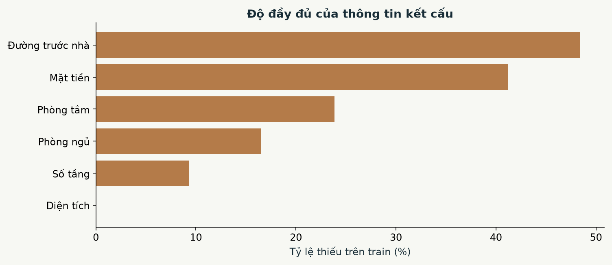

*Tỷ lệ thiếu của các biến số trên tập train*

Giá trị kết cấu ngoài miền hợp lệ được chuyển thành thiếu. Trung vị điền thiếu, cờ thiếu và các bước mã hóa được học trong train. Hướng nhà thiếu 78,3% và đường trước nhà thiếu 48,4%; các diễn giải liên quan cần thận trọng.

### 2.4 Chia dữ liệu và kiểm soát rò rỉ

Khóa nhóm gồm địa chỉ chuẩn hóa và diện tích làm tròn 0,1 m², không chứa giá. Các tin cùng khóa được giữ cùng một tập để hạn chế tin đăng lại xuất hiện ở cả train và test. Khóa vẫn có thể gộp các căn khác nhau cùng địa chỉ/diện tích và bỏ sót tin đổi cách ghi. [2]

*Phân chia dữ liệu theo nhóm*

| Tập | Số tin | Số nhóm | Vai trò |
| --- | --- | --- | --- |
| train | 13.398 | 10.220 | Fit và học tiền xử lý |
| validation | 3.271 | 2.555 | Chọn biến và mô hình |
| calibration | 2.196 | 1.704 | Hiệu chỉnh khoảng |
| test | 3.318 | 2.556 | Đánh giá cuối |

GroupShuffleSplit tách xấp xỉ 60%/15%/10%/15% số nhóm với seed 42, 43 và 44 ở các bước. Không có khóa nhóm chung giữa hai tập. Sau chọn XGBoost, chỉ fit lại train và validation. Calibration dùng hiệu chỉnh khoảng; test không dùng để chọn biến. Do thiếu ngày đăng, đây chưa phải đánh giá dự báo theo thời gian.

## CHƯƠNG 3 PHÂN TÍCH KHÁM PHÁ DỮ LIỆU

### 3.1 Phân bố giá rao bán

Biểu đồ phân bố được dựng riêng trên train. Giá nguồn bị giới hạn trong miền quan sát; hình log hỗ trợ xem thay đổi theo tỷ lệ. Mô hình học log giá, nhưng MAE, RMSE và R² được tính lại trên VND. Sai số log nhỏ hơn không tự động bảo đảm RMSE VND nhỏ hơn.

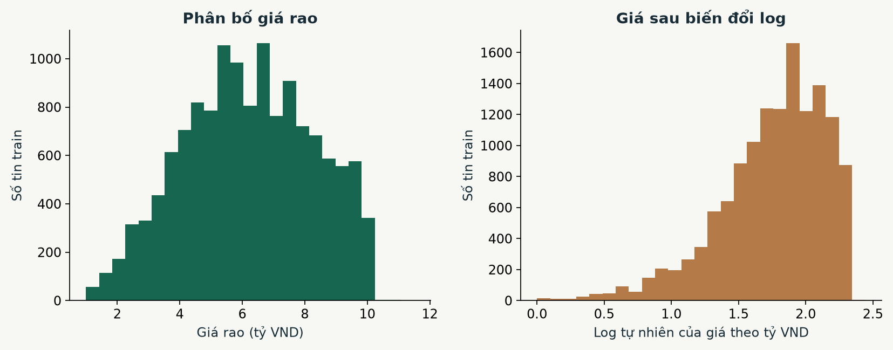

*Phân bố giá rao và giá sau biến đổi log trên train*

### 3.2 Quan hệ giữa diện tích số phòng và giá

Mỗi thành phố lấy mẫu cố định 1.200 tin train để nhìn mối liên hệ diện tích và giá. Cùng diện tích vẫn có nhiều mức giá; quy mô đơn lẻ chưa đủ định giá một căn nhà. Diện tích khai báo có thể là diện tích đất hoặc sàn, chưa được đối chiếu hồ sơ.

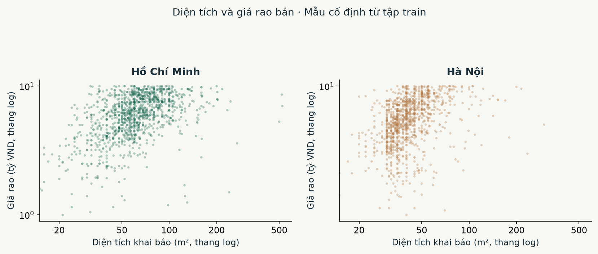

*Diện tích và giá rao trong mẫu train của hai thành phố*

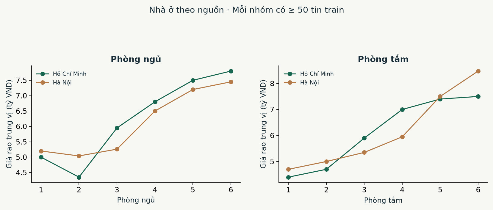

*Giá trung vị theo số phòng với ít nhất 50 tin train mỗi nhóm*

Số phòng tương quan với diện tích và kết cấu. Không suy ra một phòng ngủ hoặc phòng tắm luôn cộng một khoản tiền cố định. Dataset không có cột loại nhà nên biểu đồ gộp bất động sản trong nguồn, không được gọi riêng là nhà riêng hoặc căn hộ.

### 3.3 Phân bố giá theo địa bàn

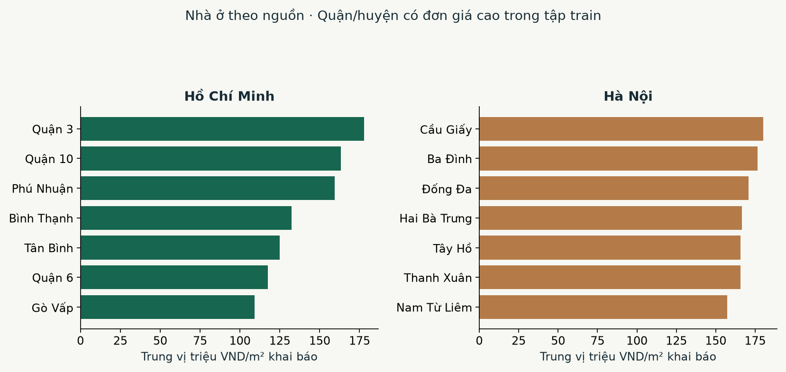

*Đơn giá trung vị ở các quận huyện có ít nhất 100 tin train*

Đơn giá giữa các địa bàn khác nhau, phù hợp với việc giữ vị trí trong mô hình. Bảng mẫu không đại diện bảng giá hiện tại của toàn thành phố. Nguồn không có tọa độ hoặc khoảng cách trường học/cửa hàng đã xác minh nên không sử dụng các đặc trưng tiện ích này.

## CHƯƠNG 4 MÔ HÌNH VÀ ĐÁNH GIÁ

### 4.1 Lựa chọn thuật toán và cấu hình

*Các mô hình trong thực nghiệm*

| Mô hình | Đặc điểm | Vai trò |
| --- | --- | --- |
| Trung vị khu vực | Trung vị giá/m² theo thành phố và quận | Đối chứng |
| OLS đầy đủ | Học log giá với 12 nhóm | Giải thích và xếp hạng |
| OLS chọn lọc | Bộ gọn theo validation | Chọn nhóm biến tuyến tính |
| XGBoost | Cây tăng cường, có hoặc không địa bàn | Mô hình phi tuyến phục vụ |

XGBoost dùng 430 cây, max_depth 6, learning_rate 0,055, min_child_weight 12, subsample 0,85, colsample_bytree 0,9, reg_lambda 6, tree_method hist, n_jobs 2 và random_state 42. Đây là cấu hình thực nghiệm, chưa tìm kiếm tối ưu toàn diện. [3]

### 4.2 Tiền xử lý và thước đo đánh giá

OLS học y = ln(giá VND); diện tích được lấy log. Sáu biến số được điền trung vị, thêm cờ thiếu và chuẩn hóa từ train. Danh mục được one-hot với nhóm tham chiếu, gộp mức hiếm. Các hệ số danh mục phụ thuộc nhóm tham chiếu nên không xếp hạng trực tiếp cùng hệ số số học. [4]

MAE là độ lệch tuyệt đối trung bình; RMSE nhạy hơn với sai số lớn; R² là hệ số xác định và không phải tỷ lệ dự đoán đúng. MdAPE là trung vị sai số phần trăm tuyệt đối. Các mô hình được chọn bằng validation; test được giữ cho đánh giá cuối.

### 4.3 Độ quan trọng bằng hồi quy tuyến tính

Mỗi lần bỏ một nhóm đầu vào, fit lại OLS trên train rồi đo mức tăng RMSE log trên cùng validation. Sai số tăng nhiều khi bỏ nhóm nghĩa là nhóm có thêm thông tin tuyến tính trong mô hình này. Cách này so sánh được biến số và danh mục, tránh xếp hạng hệ số thô khác đơn vị.

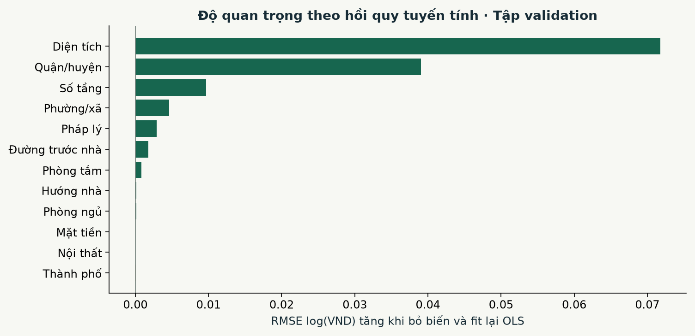

*Mức tăng RMSE log khi bỏ nhóm và fit lại OLS*

Diện tích đứng đầu với mức tăng 0,0718; tiếp theo là quận/huyện và số tầng. Giá trị gần 0 hoặc âm nghĩa là ít bổ sung thông tin sau các biến khác, chưa chứng minh biến không liên quan đến giá hoặc không có tương tác phi tuyến.

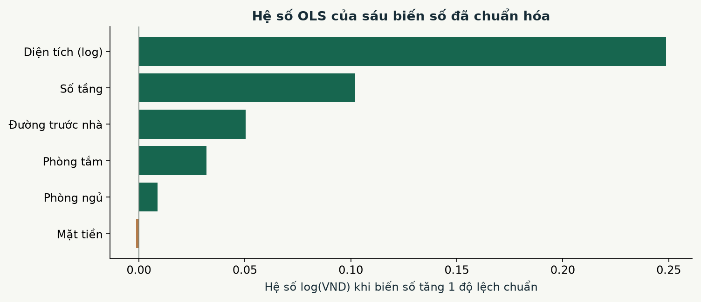

*Hệ số của sáu biến số sau chuẩn hóa trong OLS đầy đủ*

Hệ số thể hiện thay đổi dự đoán log giá khi biến số tăng một độ lệch chuẩn, với các biến khác giữ nguyên. Đây là quan hệ có điều kiện trong mẫu, chưa phải tác động nhân quả hoặc mức cộng tiền cố định.

### 4.4 Chọn số biến và lý do sử dụng

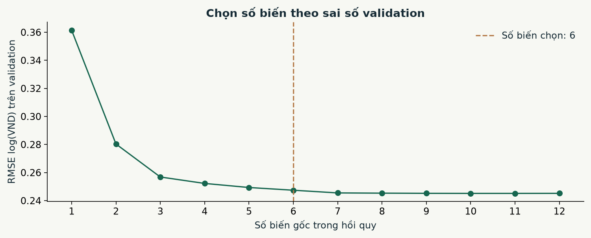

*Sai số validation khi thêm nhóm theo thứ hạng OLS*

Chọn prefix nhỏ nhất có RMSE log không quá 1% so với bộ tốt nhất. Kết quả chọn 6 nhóm, RMSE log validation 0,2474, so với 0,2452 ở OLS đầy đủ. Tiêu chí chấp nhận sai số nhỉnh hơn để có mô hình tuyến tính gọn hơn.

*Các nhóm biến OLS được chọn*

| Nhóm biến | Lý do dự báo | Lưu ý |
| --- | --- | --- |
| Diện tích | Mô tả quy mô tài sản | Đất hay sàn chưa xác minh |
| Quận/huyện | Mặt bằng giá khu vực | Địa danh theo nguồn |
| Số tầng | Bổ sung thông tin kết cấu | Không phải tiền cộng mỗi tầng |
| Phường/xã | Vị trí chi tiết hơn | Có mức hiếm và chưa rõ |
| Pháp lý | Danh mục giấy tờ và khai báo | Chưa xác minh hồ sơ |
| Đường trước nhà | Khả năng tiếp cận | Thiếu 48,4% |

Số phòng có thể chia sẻ thông tin với diện tích; thành phố lồng trong quận/huyện. Việc không chọn một nhóm vào OLS gọn không có nghĩa nhóm đó không liên quan đến giá. Pháp lý cũng có mức Không rõ nên liên hệ dự báo có thể phản ánh chất lượng khai báo và cơ cấu khu vực.

### 4.5 So sánh mô hình trên Validation

*Kết quả trên tập Validation*

| Mô hình | RMSE tỷ VND | R² |
| --- | --- | --- |
| Trung vị VND/m² theo khu vực | 2,62 | -0,605 |
| XGBoost chưa dùng địa bàn | 1,58 | 0,417 |
| XGBoost thêm địa bàn | 1,24 | 0,639 |
| OLS đủ 12 nhóm | 1,46 | 0,502 |
| OLS chọn 6 nhóm | 1,48 | 0,488 |

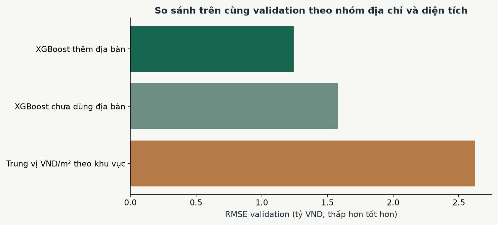

*RMSE của các mô hình XGBoost và đối chứng trên Validation*

Thêm địa bàn làm RMSE XGBoost giảm từ 1,58 xuống 1,24 tỷ VND trên validation. Ứng dụng phục vụ XGBoost với 12 nhóm. Bộ OLS sáu nhóm là thí nghiệm riêng; chưa so XGBoost sáu nhóm với XGBoost 12 nhóm, nên không khẳng định giữ 12 nhóm tốt hơn sáu nhóm cho mọi thuật toán.

### 4.6 Kết quả Test và khoảng dự đoán

*Kết quả trên tập Test giữ riêng*

| Phạm vi | Số tin | R² | MdAPE | Độ phủ |
| --- | --- | --- | --- | --- |
| Toàn bộ | 3.318 | 0,644 | 12,1% | 89,6% |
| Hà Nội | 1.591 | 0,612 | 12,6% | 90,3% |
| Hồ Chí Minh | 1.727 | 0,669 | 11,7% | 89,1% |

MAE test 0,92 tỷ VND và RMSE 1,23 tỷ VND. 72,9% tin có sai lệch không quá ±20%. Baseline có RMSE test 2,27 tỷ VND. Không so trực tiếp các chỉ số này với dataset khác có miền giá và cách chia khác.

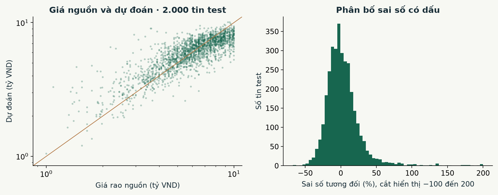

*Giá nguồn dự đoán và phân bố sai số trên Test*

Khoảng danh nghĩa 90% được hiệu chỉnh bằng phân vị phần dư tuyệt đối log giá trên calibration theo split conformal. Độ phủ quan sát trên test là 89,6%; bề rộng trung vị 4,13 tỷ VND. Độ phủ hai thành phố khác nhau; nhiều tin trong cùng nhóm có thể phụ thuộc nhau. Không bảo đảm mức phủ cho mọi phân khúc hoặc thời kỳ mới.

### 4.7 Minh họa dự đoán và giới hạn diễn giải

*Ví dụ test được chọn theo quy tắc cố định*

| Thành phố | m² | Ngủ/tắm | Giá rao tỷ | Dự đoán tỷ |
| --- | --- | --- | --- | --- |
| Hà Nội | 31 | 4/4 | 5,80 | 5,21 |
| Hồ Chí Minh | 52 | 5/3 | 6,30 | 6,56 |

Mỗi thành phố chọn tin có giá nguồn trung vị trong nhóm test khai báo đủ phòng và thuộc địa bàn được hỗ trợ, trước khi xem sai số. Ví dụ TP.HCM là Quận 2, Phường Bình Trưng Tây, 52 m²; giá rao 6,30 tỷ và dự đoán 6,56 tỷ VND. Ví dụ Hà Nội là Hà Đông, Phường Vạn Phúc, 31 m²; giá rao 5,80 tỷ và dự đoán 5,21 tỷ VND.

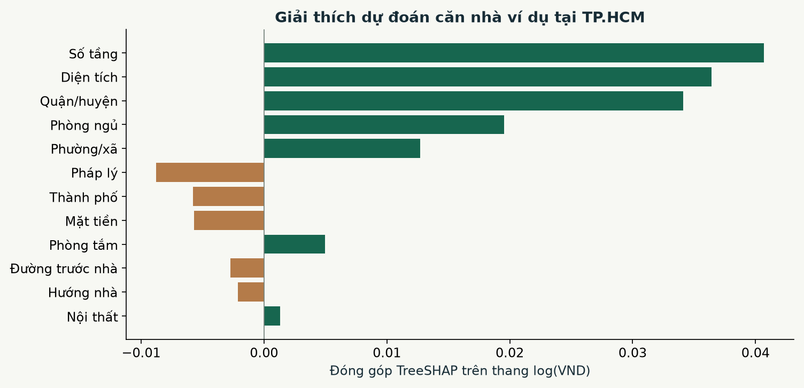

*Đóng góp TreeSHAP của ví dụ TP HCM trên thang log VND*

TreeSHAP cộng các đóng góp với mức nền trên log giá rồi lấy hàm mũ để tái tạo dự đoán trong sai số dấu phẩy động. Không đổi từng thanh thành VND rồi cộng trực tiếp. TreeSHAP giải thích XGBoost, khác phép bỏ biến và fit lại OLS. [3]

## CHƯƠNG 5 ỨNG DỤNG WEB API VÀ KIỂM THỬ

### 5.1 Kiến trúc và tổ chức mã nguồn

Trình duyệt hiển thị HTML/CSS và xử lý tương tác JavaScript; Flask phục vụ JSON API; SQLAlchemy đọc ghi SQLite. Model, quy tắc đầu vào và danh mục địa bàn cùng thuộc nguồn Kaggle 2024. Lịch sử dự đoán lưu theo phiên bản để không nhầm kết quả từ nguồn cũ.

*Trách nhiệm các thành phần ứng dụng*

| Thành phần | Vai trò |
| --- | --- |
| backend/launch_ui.py | Kiểm tra môi trường, model và cổng chạy |
| backend/kaggle_vietnam.py | Nguồn, địa chỉ và chia nhóm |
| backend/vietnam.py | Pipeline, kiểm tra đầu vào, dự đoán và TreeSHAP |
| backend/train_vietnam.py | Train, validation, calibration và test |
| backend/vietnam_api.py | API và lịch sử model hiện hành |
| backend/import_vietnam_data.py | Catalog nguồn Kaggle riêng |
| frontend/templates và static | Giao diện nhập liệu và xem kết quả |

### 5.2 Giao diện và luồng thao tác

Chọn tin mẫu chưa dùng fit hoặc nhập thành phố, quận/huyện, phường/xã và diện tích. Các thông tin số phòng, số tầng, mặt tiền, đường, hướng nhà, pháp lý và nội thất có thể để chưa biết. Bấm Dự đoán và lưu kết quả để xem giá, đơn giá, khoảng 90%, giải thích và tin đối chiếu.

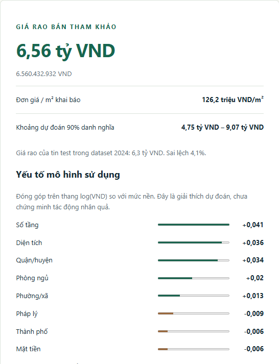

*Giao diện kết quả và giải thích dự đoán từ Kaggle 2024*

Tin đối chiếu cùng quận/huyện được lấy từ train và validation; ưu tiên gần diện tích, số phòng và phường/xã. Không hiển thị ngày đăng hoặc loại nhà chưa có, không gọi là giao dịch đã bán hoặc các căn gần nhất khi thiếu tọa độ. Nguồn và giới hạn được hiển thị ngay trên giao diện.

### 5.3 API và lưu trữ dữ liệu

*Các API Việt Nam*

| Phương thức | Đường dẫn | Chức năng |
| --- | --- | --- |
| GET | /api/vietnam/info | Nguồn, metric, schema và tin mẫu |
| POST | /api/vietnam/predict | Kiểm tra, dự đoán, giải thích và lưu |
| GET | /api/vietnam/history | Lịch sử phiên bản model hiện hành |

Catalog quan sát lưu trong vietnam_2024_listings, tách khỏi dữ liệu đã nhập trước. vietnam_predictions lưu đầu vào, dự đoán và model_version. Không dùng giá mô hình tự dự đoán làm nhãn. API từ chối giá, giá/m² hoặc cột ngoài schema; giá trị không hợp lệ không được ghi lịch sử.

SQLite đặt tại real_estate_ai/storage/real_estate.db; không cần bật PostgreSQL khi chạy chay_ui.cmd. Các bảng cũ và lịch sử vẫn được giữ; API lọc theo model hiện hành. Chương trình là ứng dụng cục bộ, chưa có xác thực để triển khai công khai.

### 5.4 Cài đặt và khởi động

Máy hiện tại đã có .venv và model. Từ thư mục Python_k18, mở TieuLuan_CuoiKy/chay_ui.cmd. Máy mới chạy scripts/cai_dat.cmd trước bằng Python 3.12. File chạy luôn dùng Python trong .venv của dự án, tránh phụ thuộc interpreter đang chọn trong VS Code.

```powershell
.\TieuLuan_CuoiKy\chay_ui.cmd
```

Launcher kiểm tra model Kaggle và SQLite. Nếu có phiên đang chạy khớp mã nguồn và model, dùng lại phiên đó; nếu cổng 8000 bị phiên khác chiếm, tự chọn cổng kế tiếp và in đúng URL. Mặc định truy cập http://127.0.0.1:8000. Giữ terminal mở khi sử dụng và Ctrl+C để dừng.

Huấn luyện lại bằng scripts/huan_luyen.cmd. Chạy scripts/analyze_vietnam_linear.py và scripts/build_vietnam_evidence.py bằng Python trong .venv để tạo lại phân tích. Notebook PhanTich_GiaNha_VietNam.ipynb kiểm tra checksum và tính lại metric từ mô hình đã khóa.

### 5.5 Kiểm thử và kết quả vận hành

Bản sửa hiện tại đạt 100 kiểm thử, bỏ qua một kiểm thử PostgreSQL do chưa cấu hình dịch vụ test. Đã kiểm tra file chay_ui.cmd thực tế, chạy mới và dùng lại phiên tương thích. Giao diện được thử dự đoán cho cả hai thành phố trên máy tính và điện thoại.

*Các nhóm hành vi được kiểm thử*

| Nhóm | Hành vi xác nhận |
| --- | --- |
| Nguồn và đơn vị | Schema 12 cột, checksum và Price nhân 1e9 |
| Chia nhóm | Tin cùng khóa cùng tập; holdout không dùng fit |
| Model | Metric khớp dự đoán và tổng đóng góp TreeSHAP |
| API và database | Từ chối nhãn trong X, chỉ lưu đầu vào hợp lệ, giữ lịch sử cũ |
| Khởi động | Dùng lại phiên khớp, tránh phiên mã nguồn cũ và cổng bận |

Kiểm thử hành vi phần mềm không thay thế đánh giá chất lượng dự đoán thị trường. Cấu hình Docker đã chứa nguồn cần thiết cho các kiểm thử; chưa công bố image mới bằng thao tác này.

## CHƯƠNG 6 KẾT LUẬN VÀ HƯỚNG PHÁT TRIỂN

### 6.1 Kết quả đạt được

Đề tài hoàn thành quy trình từ dataset Kaggle 2024 đến làm sạch, khám phá, chọn feature OLS và phục vụ XGBoost. Word, PPT và notebook dùng cùng số liệu. Bộ OLS gọn có diện tích, quận/huyện, số tầng, phường/xã, pháp lý và đường trước nhà; diện tích có thêm thông tin tuyến tính lớn nhất theo phép bỏ biến.

Test gồm 3.318 tin và có R² 0,644, MdAPE 12,1%. Kết quả cho thấy mô hình học được tín hiệu dự báo trong mẫu, đồng thời vẫn còn sai số và độ bất định đáng kể.

### 6.2 Hạn chế

Giá là giá rao năm 2024; chưa có giá chốt giao dịch, ID nhà thật, ngày đăng, loại nhà hoặc tọa độ xác minh. Phạm vi giá quan sát 1–11,5 tỷ VND không đại diện toàn thị trường. Diện tích có thể là đất hoặc sàn; tỷ lệ thiếu một số thuộc tính cao.

Chia nhóm địa chỉ và diện tích chỉ hạn chế một phần trùng lặp. Chưa kiểm định theo thời gian hoặc độ bền qua nhiều lần chia. Các hệ số OLS và đóng góp TreeSHAP không chứng minh nhân quả. Khoảng dự đoán hiệu chỉnh gộp không bảo đảm độ phủ ở mọi thành phố hoặc phân khúc.

### 6.3 Hướng phát triển

Ưu tiên bổ sung ngày đăng, ID ổn định, nguồn giao dịch đã xác minh và diện tích thống nhất. Khi có dữ liệu mới, đánh giá theo thời gian/vùng, kiểm tra độ bền lựa chọn biến và so XGBoost sáu nhóm với XGBoost 12 nhóm trên validation riêng.

Có thể bổ sung tiện ích khi có tọa độ và snapshot POI cùng thời kỳ, rồi đo phần cải thiện trên holdout mới. Phân tích sai số và hiệu chỉnh khoảng theo phân khúc cần được kiểm tra trước khi sử dụng ngoài mục đích học tập.

## TÀI LIỆU THAM KHẢO

[1] Nguyen Tien Nhan. House Price Prediction Dataset Vietnam 2024. Kaggle, phiên bản 8, CC0 Public Domain. https://www.kaggle.com/datasets/nguyentiennhan/vietnam-housing-dataset-2024

[2] Scikit-learn. GroupShuffleSplit. https://scikit-learn.org/stable/modules/generated/sklearn.model_selection.GroupShuffleSplit.html

[3] XGBoost. Prediction và pred_contribs. https://xgboost.readthedocs.io/en/stable/prediction.html

[4] Scikit-learn. LinearRegression. https://scikit-learn.org/stable/modules/generated/sklearn.linear_model.LinearRegression.html

Các nguồn được đối chiếu ngày 07/11/2026. Số liệu tái lập trong artifacts/vietnam/metadata.json, linear_analysis.json, split.json và test_predictions.csv.

Mã model: vn2024-8ea036e9d9fe. SHA256 CSV nguồn: 7ee188d69aca06349a81bac0c2d2d1503058d5aec7124edfd075154fa87d97c8.

## BẢNG PHÂN CÔNG NHIỆM VỤ

*Các hạng mục thực hiện*

| Hạng mục | Sản phẩm | Người phụ trách |
| --- | --- | --- |
| Dữ liệu và tiền xử lý | CSV xác minh, nhóm và notebook | Nguyễn Duy Trường |
| Mô hình và phân tích | OLS, XGBoost, biểu đồ và metric | Nguyễn Duy Trường |
| Ứng dụng và kiểm thử | Giao diện, API, SQLite và launcher | Nguyễn Duy Trường |
| Tài liệu | Word và PowerPoint cùng nguồn Kaggle | Nguyễn Duy Trường |
