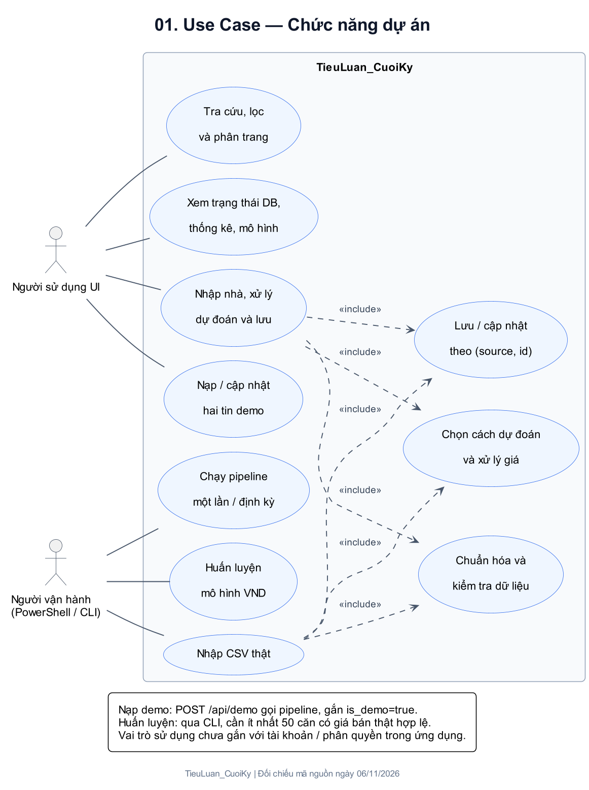
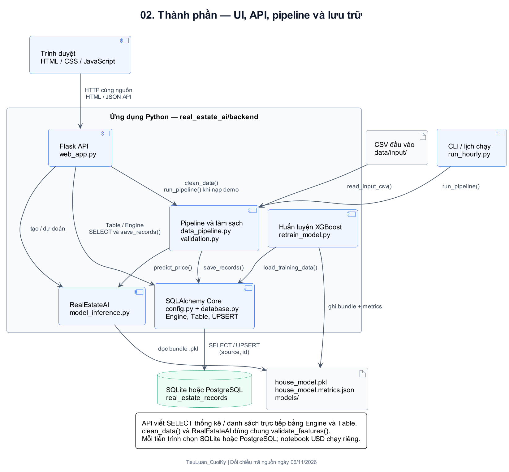
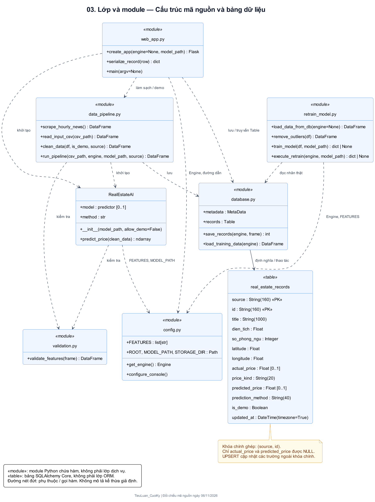
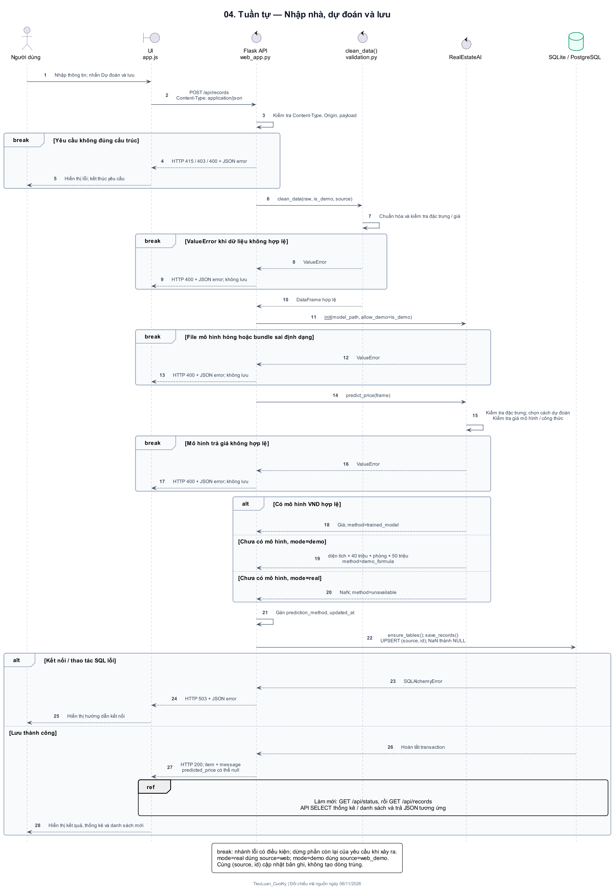
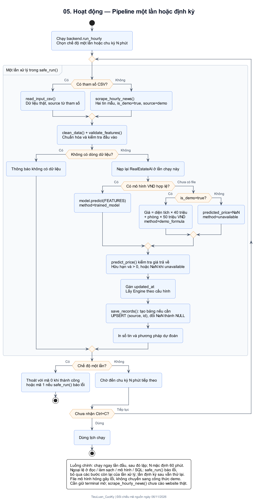
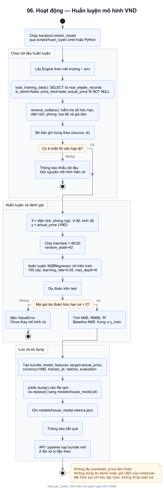
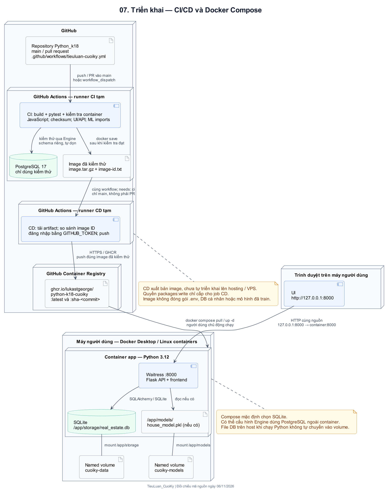

# Sơ đồ UML — TieuLuan_CuoiKy

Bộ sơ đồ mô tả phiên bản UI/API, pipeline, mô hình VND và CI/CD đã được triển khai trong dự án. Nội dung được đối chiếu với mã nguồn ngày **06/11/2026**.

## Danh sách sơ đồ

| STT | Sơ đồ | Nội dung | Tệp |
|---|---|---|---|
| 01 | Use Case | Người sử dụng UI, người vận hành và các chức năng hiện có | [SVG](uml/svg/01_use_case.svg) · [PNG](uml/png/01_use_case.png) · [PlantUML](uml/source/01_use_case.puml) |
| 02 | Thành phần | Quan hệ giữa frontend, Flask API, pipeline, mô hình và database | [SVG](uml/svg/02_components.svg) · [PNG](uml/png/02_components.png) · [PlantUML](uml/source/02_components.puml) |
| 03 | Lớp và module | Lớp `RealEstateAI`, các module Python và cấu trúc bảng dữ liệu | [SVG](uml/svg/03_classes_modules.svg) · [PNG](uml/png/03_classes_modules.png) · [PlantUML](uml/source/03_classes_modules.puml) |
| 04 | Tuần tự | Nhập nhà → kiểm tra → dự đoán → lưu → cập nhật giao diện | [SVG](uml/svg/04_sequence_predict_save.svg) · [PNG](uml/png/04_sequence_predict_save.png) · [PlantUML](uml/source/04_sequence_predict_save.puml) |
| 05 | Hoạt động pipeline | Chạy một lần/định kỳ; đầu vào CSV/demo; xử lý lỗi và lưu dữ liệu | [SVG](uml/svg/05_activity_pipeline.svg) · [PNG](uml/png/05_activity_pipeline.png) · [PlantUML](uml/source/05_activity_pipeline.puml) |
| 06 | Hoạt động huấn luyện | Chọn nhãn thật, làm sạch, chia train/test, đánh giá và lưu bundle | [SVG](uml/svg/06_activity_training.svg) · [PNG](uml/png/06_activity_training.png) · [PlantUML](uml/source/06_activity_training.puml) |
| 07 | Triển khai | GitHub Actions CI/CD, GHCR, Docker Compose và volume dữ liệu | [SVG](uml/svg/07_deployment_cicd_docker.svg) · [PNG](uml/png/07_deployment_cicd_docker.png) · [PlantUML](uml/source/07_deployment_cicd_docker.puml) |

**Xem và sử dụng:** mở SVG để phóng to rõ chữ; chèn PNG vào báo cáo Word. Với sơ đồ rộng, nên đặt trang Word nằm ngang. Các tệp `.puml` là mã nguồn để chỉnh sửa; `theme.iuml` quản lý kiểu trình bày chung.

## 01. Use Case — Chức năng



- Người sử dụng nhập và lưu thông tin nhà, nạp tin demo, tra cứu danh sách và xem trạng thái hệ thống qua UI.
- Người vận hành nhập CSV, chạy pipeline theo lịch hoặc huấn luyện mô hình qua PowerShell/CLI.
- `«include»` chỉ phần xử lý bắt buộc trong chức năng nhập và lưu; không đại diện một API riêng cho từng bước.

Hai vai trò mô tả cách sử dụng ứng dụng. Hệ thống hiện chưa có tài khoản hay đăng nhập/phân quyền; huấn luyện chưa được đưa lên UI. Pipeline theo lịch chạy trong terminal, cần giữ tiến trình hoạt động.

## 02. Thành phần — Kiến trúc ứng dụng



Frontend gọi API bằng `fetch`. Flask điều phối làm sạch dữ liệu, dự đoán và lưu; các truy vấn danh sách/thống kê được viết ngay trong `web_app.py` bằng SQLAlchemy. Pipeline CLI dùng chung phần làm sạch, dự đoán và truy cập dữ liệu. Mô hình VND được lưu dưới dạng bundle trong `models/`.

SQLite và PostgreSQL là hai lựa chọn backend của Engine. Notebook King County dùng USD, chạy độc lập với luồng ứng dụng VND.

Đối chiếu: [web_app.py](../real_estate_ai/backend/web_app.py), [data_pipeline.py](../real_estate_ai/backend/data_pipeline.py), [database.py](../real_estate_ai/backend/database.py), [config.py](../real_estate_ai/backend/config.py).

## 03. Lớp, module và dữ liệu



`RealEstateAI` là lớp Python trong mã nguồn. Các thành phần `«module»` biểu diễn module chứa hàm; tên hàm, thuộc tính và quan hệ phụ thuộc được rút gọn để đọc sơ đồ. `«table» real_estate_records` mô tả bảng SQLAlchemy Core, không phải lớp ORM.

Khóa chính ghép là **`(source, id)`**. `save_records()` thực hiện UPSERT, cập nhật các trường còn lại nếu khóa đã tồn tại. `actual_price` và `predicted_price` có thể NULL; dữ liệu demo được phân biệt qua `is_demo`.

Đối chiếu: [model_inference.py](../real_estate_ai/backend/model_inference.py), [database.py](../real_estate_ai/backend/database.py), [validation.py](../real_estate_ai/backend/validation.py), [retrain_model.py](../real_estate_ai/backend/retrain_model.py).

## 04. Tuần tự — Dự đoán và lưu từ UI



Luồng chính sử dụng `POST /api/records`. Sau khi lưu thành công, UI gọi `GET /api/status` và `GET /api/records` để làm mới thống kê và danh sách.

Các fragment `break` biểu diễn nhánh lỗi có điều kiện: khi lỗi tương ứng xảy ra, phần còn lại của yêu cầu dừng lại. Khối `ref` gộp bước làm mới thống kê/danh sách để sơ đồ dễ đọc.

| Tình huống | Kết quả |
|---|---|
| Có bundle mô hình VND hợp lệ | Dùng mô hình, `prediction_method=trained_model` |
| Thiếu file mô hình, `mode=demo` | Dùng công thức minh họa, `prediction_method=demo_formula` |
| Thiếu file mô hình, `mode=real` | Lưu `predicted_price=NULL`, `prediction_method=unavailable` |
| Mô hình hỏng/sai định dạng hoặc đầu vào không hợp lệ | HTTP 400, không lưu |
| Sai kiểu nội dung hoặc Origin khác UI | HTTP 415 hoặc 403, không lưu |
| Kết nối/thao tác database thất bại | HTTP 503; UI hiển thị lỗi |

`mode=real` dùng nguồn `web`; `mode=demo` dùng `web_demo`. API `/api/demo` là luồng nạp hai tin mẫu khác, dùng nguồn `demo` và gọi `run_pipeline()`.

## 05. Hoạt động — Pipeline một lần hoặc định kỳ



`backend.run_hourly` chạy ngay lần đầu. Nếu có `--once`, tiến trình trả mã thoát 0/1 theo kết quả; nếu chạy định kỳ, chu kỳ mặc định là 60 phút và một lần lỗi vẫn được thử lại ở chu kỳ kế tiếp.

Sơ đồ tập trung vào luồng xử lý chính. Các ngoại lệ khi đọc dữ liệu, nạp mô hình hoặc thao tác database được ghi chú trong phần chú giải; `safe_run()` báo lỗi và bỏ qua các bước còn lại của lần xử lý đó.

Khi chỉ định `--csv`, chương trình đọc dữ liệu thật từ CSV. Khi bỏ `--csv`, hàm `scrape_hourly_news()` hiện trả hai tin mẫu; tên hàm được giữ từ phiên bản cũ. Tọa độ và giá minh họa có nhãn rõ ràng; chưa có tác vụ cào website thật.

Đối chiếu: [run_hourly.py](../real_estate_ai/backend/run_hourly.py), [data_pipeline.py](../real_estate_ai/backend/data_pipeline.py).

## 06. Hoạt động — Huấn luyện mô hình VND



Huấn luyện chỉ lấy dữ liệu `is_demo=false`, `price_kind=sale`, có `actual_price`, sau đó làm sạch và bỏ trùng. Cần ít nhất **50 căn hợp lệ**. Giá dự đoán, giá demo và dữ liệu USD của notebook không được dùng làm nhãn VND.

Dữ liệu được chia train/test 80/20 với seed 42. XGBoost chỉ học trên train; các chỉ số MAE, RMSE, R² và MAE baseline được tính trên test. Bundle được ghi qua file tạm rồi thay thế file mô hình bằng `os.replace()`; tệp metrics được ghi riêng. API/pipeline nạp mô hình ở lần xử lý tiếp theo.

Sơ đồ mô tả luồng nghiệp vụ cùng các nhánh thiếu dữ liệu/dự đoán không hợp lệ. Lỗi truy cập database hoặc ghi file được xử lý tại CLI theo mã nguồn; đây không phải cơ chế huấn luyện tự động trên GitHub Actions.

Đối chiếu: [retrain_model.py](../real_estate_ai/backend/retrain_model.py), [load_training_data()](../real_estate_ai/backend/database.py).

## 07. Triển khai — CI/CD và Docker



CI build image, chạy kiểm thử SQLite/PostgreSQL, kiểm tra dataset và thử UI/API trong container. CD chỉ chạy sau khi CI đạt trên `main`, tải lại đúng image đã kiểm thử, đối chiếu image ID rồi push lên GHCR với tag `latest` và `sha-<commit>`.

Người dùng chủ động chạy Docker Compose để kéo image và mở UI. Cấu hình Compose mặc định dùng SQLite, cổng host `127.0.0.1:8000` và hai named volume `cuoiky-data`, `cuoiky-models`. PostgreSQL dùng trong CI là dịch vụ tạm, không phải database ứng dụng trên máy người dùng.

Sơ đồ tập trung vào cách triển khai Docker đã có. Khi chạy `chay_ui.cmd`, Flask chạy trực tiếp trên máy và dùng file `real_estate_ai/storage/real_estate.db`; dữ liệu này độc lập với volume Docker. CD hiện xuất bản image, chưa tự triển khai lên hosting/VPS.

Đối chiếu: [workflow](../../.github/workflows/tieuluan-cuoiky.yml), [Dockerfile](../deploy/Dockerfile), [compose.yaml](../deploy/compose.yaml), [hướng dẫn CI/CD](CI_CD.md).

## Cấu trúc tệp và cách xuất lại ảnh

```text
docs/
├── UML.md
└── uml/
    ├── source/       # 7 tệp .puml và theme.iuml
    ├── svg/          # 7 ảnh vector, phù hợp để phóng to
    └── png/          # 7 ảnh để chèn vào Word
```

Chỉnh các tệp trong `uml/source/`, rồi mở PowerShell tại gốc repository `Python_k18`:

```powershell
.\TieuLuan_CuoiKy\scripts\render_uml.ps1
```

Máy cần chạy được lệnh `java`. Script ưu tiên PlantUML có sẵn từ tiện ích VS Code `jebbs.plantuml`; bộ ảnh bàn giao được dựng bằng PlantUML 1.2024.3 của tiện ích trên máy này. Nếu chưa có, script tải bản 1.2026.9 từ Maven Central, kiểm tra SHA-256 và lưu JAR trong `.tools/uml-tools/` được Git bỏ qua. Có thể truyền đường dẫn JAR cục bộ qua `-PlantUmlJar`.

Sơ đồ được render cục bộ bằng Smetana, không cần cài Graphviz riêng. Khi đã có JAR, có thể xuất lại ảnh mà không cần mạng. Tham khảo [mã nguồn và các bản phát hành PlantUML](https://github.com/plantuml/plantuml/releases).

Chỉ xuất một định dạng nếu cần:

```powershell
.\TieuLuan_CuoiKy\scripts\render_uml.ps1 -Format Svg
.\TieuLuan_CuoiKy\scripts\render_uml.ps1 -Format Png
```

Giữ các tệp nguồn và ảnh đã xuất cùng nhau khi bàn giao để có thể xem ngay và chỉnh sửa sau này.
