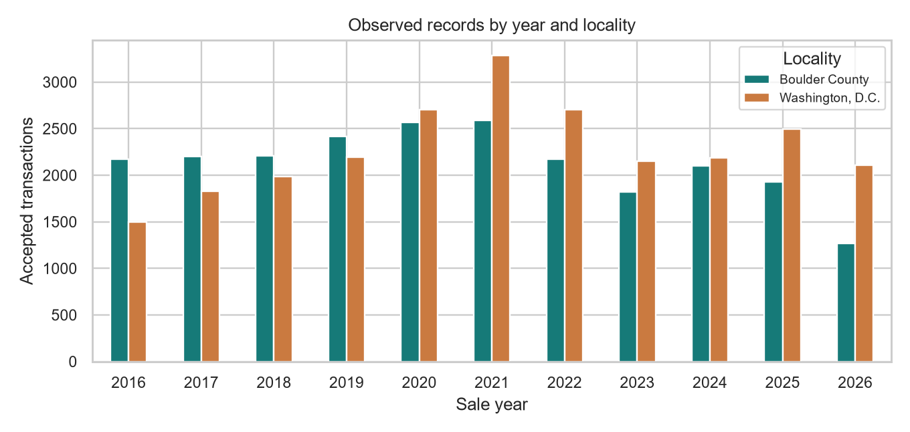
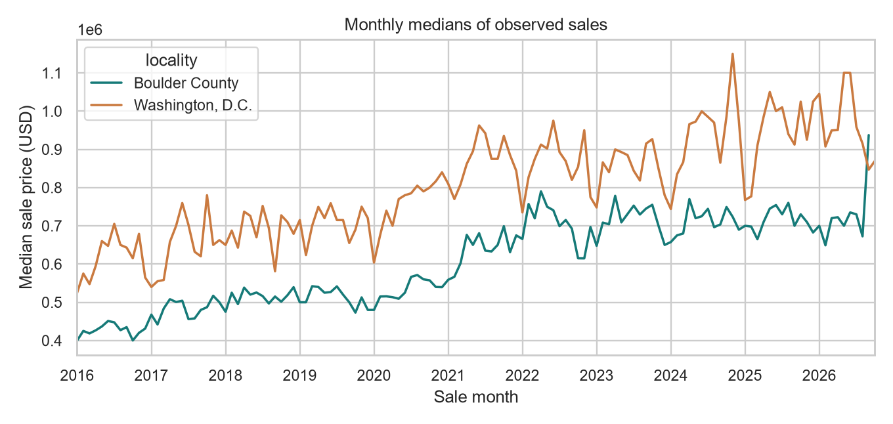
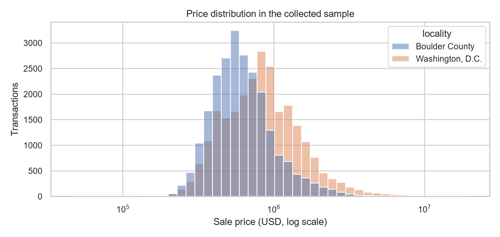
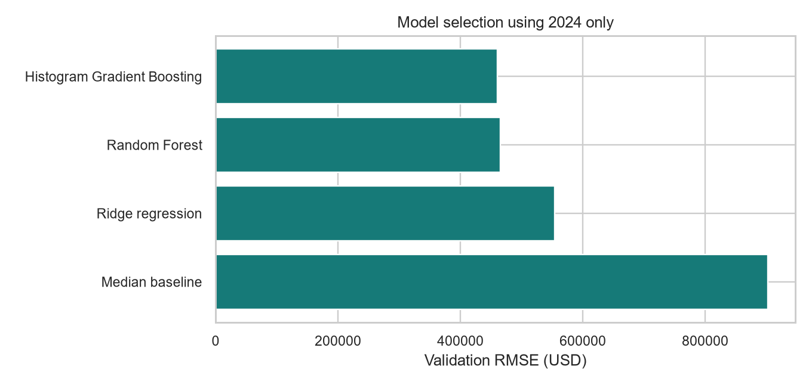
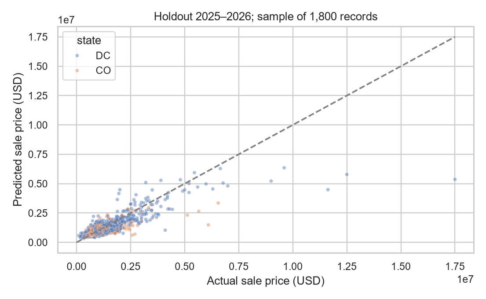
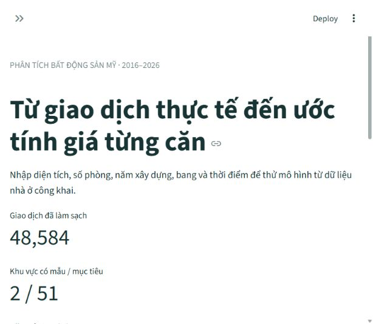

Bảng 1. Các từ viết tắt và đơn vị
Ký hiệu | Ý nghĩa
CAMA | Computer Assisted Mass Appraisal; hệ thống định giá hàng loạt
DC / CO | Washington, D.C. / Colorado
EDA | Phân tích khám phá dữ liệu
GBA | Gross Building Area; tổng diện tích xây dựng
MAE | Sai số tuyệt đối trung bình
RMSE | Căn sai số bình phương trung bình
R² | Hệ số xác định
USD | Đô la Mỹ
ft² | Feet vuông; 1 ft² = 0,09290304 m²
CSV | Tệp dữ liệu phân cách bằng dấu phẩy
SQLite | Cơ sở dữ liệu quan hệ lưu trong một tệp

## CHƯƠNG 1 TỔNG QUAN ĐỀ TÀI

### 1.1 Bài toán và kết quả chính

Tiểu luận xây dựng quy trình phân tích giá bán nhà ở và ứng dụng dự đoán giá từng căn từ vị trí, diện tích, số phòng, năm xây dựng và thời điểm định giá. Sản phẩm kết hợp dữ liệu công khai, cơ sở dữ liệu SQLite, các mô hình hồi quy và giao diện Streamlit tiếng Việt. Mục tiêu là tái lập được kết quả và trình bày rõ phạm vi áp dụng của mô hình.

Mục tiêu thu thập gồm 50 bang của Mỹ và Washington, D.C., từ năm 2016 đến 2026. Bản dữ liệu xử lý ngày 2026-10-26 có 48,584 giao dịch tại Boulder County thuộc Colorado và Washington, D.C. Chưa có dữ liệu của 49 bang còn lại; Colorado chưa phủ toàn bang. Ứng dụng hiển thị toàn bộ 51 khu vực trong bảng độ phủ và chặn dự đoán ở khu vực chưa có dữ liệu.

Mô hình được chọn là Histogram Gradient Boosting. Sai số tuyệt đối trung bình trên tập kiểm thử xấp xỉ 266 nghìn USD, cho thấy kết quả hiện chỉ phù hợp minh họa học máy. Đặc điểm nhà lấy từ hồ sơ hiện hành của cơ quan thuế, chưa được xác minh đúng tại thời điểm bán; hạn chế này cần được giữ khi diễn giải mọi kết quả.

### 1.2 Phạm vi và câu hỏi nghiên cứu

Nhãn dự đoán là giá bán USD gắn với ngày bán của từng căn. Giá nhà điển hình theo bang không thay thế nhãn giao dịch. Tương tự, giá niêm yết hiện tại không được ghép với ngày bán trước đây để tạo dữ liệu lịch sử. Năm 2026 mới có phần giao dịch đã được công bố tại thời điểm tải.

Nghiên cứu xem xét phân phối giá, biến động trung vị theo tháng và chênh lệch giữa hai khu vực có mẫu; đồng thời so sánh hồi quy tuyến tính có điều chuẩn với các mô hình cây. Phân tích là mô tả và dự đoán, không suy ra quan hệ nhân quả hoặc khẳng định giá thị trường của một căn nhà cụ thể.

### 1.3 Công nghệ và cấu trúc

Bảng 2. Công nghệ sử dụng
Thành phần | Vai trò
Python và SQLite | Thu thập, kiểm tra và lưu giao dịch có nguồn gốc
Pandas và NumPy | Chuẩn hóa bảng, thống kê và biến đổi mảng
Matplotlib và Seaborn | Vẽ xu hướng, phân phối và sai số
scikit-learn và joblib | Pipeline, huấn luyện và lưu mô hình
Streamlit và pytest | Giao diện và kiểm thử tự động

## CHƯƠNG 2 DỮ LIỆU VÀ TIỀN XỬ LÝ

### 2.1 Nguồn và phạm vi thu thập

Nguồn Boulder County cung cấp Sales.csv và Buildings.csv [1]. Dự án ghép giao dịch với đặc điểm theo mã tài sản strap. Nguồn DC GIS cung cấp bảng Residential CAMA với giá, ngày bán và thuộc tính công trình [2], [3]. Đây là các hồ sơ địa phương được công bố công khai; không mặc định chúng đầy đủ cho toàn bộ thị trường Mỹ.

Bảng 3. Dữ liệu sau làm sạch
Khu vực | Giao dịch | Ngày bán từ đến
Boulder County thuộc Colorado | 23.449 | 04/01/2016 đến 09/09/2026
Washington, D.C. | 25.135 | 04/01/2016 đến 15/10/2026
49 bang còn lại | 0 | Chưa có trong database

Boulder chỉ giữ nhà một gia đình có duy nhất một bản ghi công trình/phần công trình. DC giữ nhà một đơn vị và một công trình chính, bỏ SSL trùng và loại cấu trúc Multi. Cả hai nguồn chỉ giữ mã giao dịch Q. Tại Boulder, một văn tự chuyển nhượng liên quan nhiều tài sản bị loại để tránh gán toàn bộ giá của nhiều tài sản cho một căn.

### 2.2 Schema và đơn vị

Bảng 4. Các nhóm trường dữ liệu
Nhóm | Trường và ý nghĩa
Định danh và nguồn | transaction_id, property_id, source_id; không dùng làm đặc trưng
Vị trí | state, locality; xác định đúng bang và phạm vi quận/thành phố
Giá và thời gian | price_usd, sale_date; sale_year và sale_month được suy ra từ ngày
Công trình | area_sqft, area_kind, bedrooms, bathrooms, year_built
Phiên bản đặc điểm | feature_snapshot_date, feature_vintage; ghi rõ hồ sơ hiện hành

Diện tích Boulder là TotalFinishedSF, tổng diện tích hoàn thiện; DC là GBA, tổng diện tích xây dựng tính bằng ft². Trường area_kind bảo toàn khác biệt này. Phòng tắm được quy đổi: đầy đủ bằng 1, ba phần tư bằng 0,75 và một nửa bằng 0,5. Giao diện cho phép nhập m² rồi đổi sang ft² trước khi dự đoán.

### 2.3 Làm sạch và kiểm tra

Loại bản ghi ngoài 2016–ngày xử lý, kể cả ngày tương lai; nguồn Boulder có ba bản ghi ngày bán tương lai đã bị loại. Loại năm xây sau năm bán và năm cải tạo DC sau năm bán; tại Boulder loại EffectiveYear lớn hơn năm bán. Bộ lọc tiếp tục yêu cầu giá 10.000–20.000.000 USD, diện tích 200–20.000 ft², số phòng ngủ nguyên từ 0–15 và số phòng tắm 0,5–15. Đây là giới hạn thực nghiệm, có thể loại các tài sản đặc biệt và làm thay đổi tính đại diện của mẫu.

Không tự điền diện tích hoặc số phòng còn thiếu. Bản ghi có thuộc tính bắt buộc không hợp lệ bị loại; trùng transaction_id có giá khác nhau bị loại thay vì chọn tùy ý. Mỗi bước có số lượng audit. Database có khóa chính, khóa ngoại, kiểm tra toàn vẹn; dữ liệu nguồn được giữ cùng mã SHA-256 để kiểm tra phiên bản.

## CHƯƠNG 3 PHÂN TÍCH KHÁM PHÁ

### 3.1 Độ phủ và thiên lệch mẫu

Bảng độ phủ gồm 561 tổ hợp khu vực và năm. Có mẫu cho các năm 2016–2026 ở hai khu vực đã thu thập; mọi ô của 49 bang còn lại bằng 0. Số 0 thể hiện khoảng trống của database, không phải không có giao dịch ngoài thị trường. Các biểu đồ dưới đây mô tả toàn bộ dữ liệu được giữ lại, không được dùng để chọn mô hình.

Số bản ghi chịu ảnh hưởng bởi phạm vi công bố và bộ lọc, nên không dùng trực tiếp để kết luận thanh khoản tăng hay giảm. DC chủ yếu giữ lần bán gần nhất của tài sản trong snapshot, trong khi Boulder có lịch sử bán ghép vào hồ sơ công trình hiện hành. Hai cách quan sát không hoàn toàn tương đương.

### 3.2 Trung vị giá theo thời gian

Các đường biểu diễn được chồng trên cùng trục thời gian để so sánh hai khu vực. Trung vị ít nhạy với vài căn giá rất cao hơn trung bình, nhưng vẫn thay đổi khi thành phần nhà bán trong tháng thay đổi. Biểu đồ không phải chỉ số giá cho cùng một tập căn nhà và chưa điều chỉnh lạm phát.

### 3.3 Phân phối giá

Giá có đuôi phải dài và trải qua nhiều mức, dẫn đến các lỗi USD lớn ở nhóm nhà đắt. Biến đổi log1p của giá giúp việc học chú ý đến tỷ lệ chênh lệch; các dự đoán vẫn được đổi về USD để đánh giá. Chỉ có vị trí ở cấp quận/thành phố nên mô hình bỏ qua khác biệt giữa nhiều khu phố.

## CHƯƠNG 4 MÔ HÌNH VÀ ĐÁNH GIÁ

### 4.1 Thiết kế thực nghiệm

Train gồm 34,706 giao dịch năm 2016–2023; validation gồm 4,214 giao dịch năm 2024; test gồm 7,804 giao dịch năm 2025–2026. Loại 1,860 giao dịch cũ của tài sản thuộc tập giữ lại. Tập test được xác định trước, sau đó validation và train được loại các property_id giao nhau; không trộn ngẫu nhiên các lần bán của cùng căn.

Pipeline dùng StandardScaler cho biến số và OneHotEncoder cho bang, locality, area_kind. Các tham số được học trên tập train tương ứng [4]. Mục tiêu dùng log1p rồi expm1 khi dự đoán. Mã căn nhà và giá bán trước không được dùng làm đặc trưng. Biến thời gian là năm/tháng, không đưa ngày tải hoặc feature_snapshot_date vào mô hình.

### 4.2 So sánh mô hình

Bảng 5. Kết quả validation năm 2024
Mô hình | MAE USD | RMSE USD | R²
Histogram Gradient Boosting | 245,324 | 460,546 | 0.681
Random Forest | 246,860 | 465,143 | 0.675
Ridge regression | 292,077 | 553,755 | 0.539
Median baseline | 476,395 | 902,557 | -0.224

Median baseline tạo mốc so sánh. Ridge điều chuẩn mô hình tuyến tính; Random Forest trung bình hóa nhiều cây; Histogram Gradient Boosting bổ sung cây tuần tự [5]. Mô hình sau có RMSE validation thấp nhất và được chọn trước khi xem test. Cấu hình và seed 42 được lưu trong scripts/train_us.py.

### 4.3 Kiểm thử độc lập và giới hạn

Mô hình được chọn được fit lại bằng train cộng validation, giữ các căn trong test ngoài quá trình fit. Kết quả test: MAE 265,745.75 USD, RMSE 520,761.74 USD và R² 0.6862. MAE là trung bình độ lớn sai số; RMSE phạt lỗi lớn mạnh hơn. R² không phải tỷ lệ phần trăm dự đoán đúng.

Sai số còn lớn, đặc biệt khi giá cao. Đặc điểm công trình chưa có vintage đúng tại ngày bán; việc tách theo thời gian và mã nhà không loại bỏ hoàn toàn rò rỉ do đặc điểm hiện hành. Do đó đây là đánh giá thực nghiệm của bản dữ liệu đã ghép, chưa phải kiểm thử một hệ thống dự báo chỉ dùng thông tin có sẵn tại từng thời điểm.

evaluation_model.joblib giữ bản mô hình để tái lập điểm test. model.joblib là bản phục vụ giao diện, được fit lại bằng toàn bộ dữ liệu hợp lệ để tận dụng giao dịch mới. Điểm test công bố không được gán cho bản mô hình đã học toàn bộ dữ liệu.

## CHƯƠNG 5 ỨNG DỤNG VÀ KIỂM THỬ

### 5.1 Các chức năng

Giao diện có năm trang: Tổng quan, Khám phá dữ liệu, Dự đoán giá nhà, Độ phủ 51 khu vực và Đánh giá mô hình. Người dùng chọn bang, quận/thành phố có dữ liệu, tháng/năm và đặc điểm căn nhà. Ở bang chưa hỗ trợ, biểu mẫu dừng trước nút dự đoán. Dự đoán theo lô nhận tối đa 2.000 dòng CSV và 4 MB, dùng cùng hàm kiểm tra như dự đoán một căn.

### 5.2 Kiểm tra đầu vào và kết quả

Ứng dụng từ chối giá trị thiếu, vô hạn, số phòng ngủ không nguyên, diện tích ngoài khoảng đã quan sát của địa phương, tháng/năm ngoài thời gian hỗ trợ, năm xây sau thời điểm định giá và loại diện tích sai nguồn. Các giới hạn từng cột chưa đảm bảo mọi tổ hợp là phổ biến trong tập huấn luyện; ứng dụng chưa có khoảng dự đoán đã hiệu chuẩn.

Bộ kiểm thử đạt 36 test, gồm kiểm tra hồi quy bản Ames được giữ riêng. Kiểm thử mới xác nhận toàn vẹn SQLite, số ô độ phủ, bản ghi ngày tương lai, tính nhất quán dự đoán một căn/theo lô, nhóm tài sản không giao nhau và khả năng tái lập điểm test từ mô hình lưu. AppTest kiểm tra các trang, dự đoán tại CO/DC và chặn bang CA thiếu dữ liệu [6].

### 5.3 Chạy và tái lập

Tại thư mục TieuLuan_GiaNha, chạy .venv\Scripts\python.exe -m streamlit run app.py hoặc nhấp đúp chay_demo.cmd. Mặc định mở localhost:8501. Database và mô hình đi kèm cho phép demo ngoại tuyến sau khi cài thư viện. Cần Internet khi chạy scripts.fetch_us_data để tải lại snapshot nguồn.

Thứ tự tái lập là fetch_us_data, build_us_database, train_us, visualize_us và pytest. Sau khi đổi database, SHA-256 phải khớp metadata mô hình; nếu không, ứng dụng yêu cầu huấn luyện lại. README và kịch bản demo mô tả lệnh cụ thể. Chưa có đường dẫn GitHub công khai được tạo trong bản bàn giao này.

## CHƯƠNG 6 KẾT LUẬN VÀ HƯỚNG PHÁT TRIỂN

### 6.1 Kết quả đạt được

Sản phẩm đã chuyển từ một bộ dữ liệu Ames cũ sang SQLite lưu giá bán từng căn có nguồn và thời gian trong giai đoạn 2016–2026. Quy trình tải, lọc, lập bảng độ phủ, huấn luyện, kiểm thử và trình bày đã được triển khai. Giao diện dự đoán từ diện tích/số phòng và cho phép người dùng quan sát phần dữ liệu còn thiếu.

Mục tiêu toàn quốc chưa đạt về dữ liệu: chỉ có mẫu từ hai khu vực và Colorado còn giới hạn trong một quận. Công bố rõ khoảng trống tránh diễn giải mô hình địa phương thành mô hình toàn Mỹ. Hiệu năng trên validation và test tốt hơn baseline nhưng sai số USD lớn nên chưa đủ để sử dụng như công cụ định giá thực tế.

### 6.2 Hạn chế và hướng mở rộng

Ưu tiên tiếp theo là bổ sung nguồn công khai có giá–ngày giao dịch tương ứng cho các bang còn thiếu, dữ liệu công trình theo đúng thời điểm lịch sử và vị trí chi tiết như khu phố hoặc mã ZIP. Cần đánh giá lại từng locality, ghi phạm vi và độ trễ công bố, không tự mở dự đoán chỉ vì đã có một số bản ghi của bang.

Các hướng kỹ thuật gồm kiểm định cuốn chiếu theo thời gian, phân tích sai số theo phân khúc giá/loại nhà, khoảng dự đoán được hiệu chuẩn và phát hiện đầu vào khác xa mẫu huấn luyện. Việc xử lý thiên lệch do đặc điểm hiện hành và tài sản đã rời hồ sơ cần được giải quyết trước khi khẳng định khả năng dự báo thời gian thực.

## TÀI LIỆU THAM KHẢO

[1] Boulder County Assessor, “Data Download”. https://bouldercounty.gov/property-and-land/assessor/data-download/. Truy cập 26/10/2026.

[2] District of Columbia GIS, “Residential CAMA”. https://maps2.dcgis.dc.gov/dcgis/rest/services/DCGIS_DATA/Property_and_Land_WebMercator/FeatureServer/25. Truy cập 26/10/2026.

[3] DC GIS, “DCGIS.CamaResPt metadata”. https://dcatlas.dcgis.dc.gov/metadata/CamaResPt.html. Truy cập 26/10/2026.

[4] scikit-learn developers, “Common pitfalls and recommended practices”. https://scikit-learn.org/stable/common_pitfalls.html. Truy cập 26/10/2026.

[5] scikit-learn developers, “Ensemble methods”. https://scikit-learn.org/stable/modules/ensemble.html. Truy cập 26/10/2026.

[6] Streamlit, “AppTest”. https://docs.streamlit.io/develop/api-reference/app-testing/st.testing.v1.apptest. Truy cập 26/10/2026.

## BẢNG PHÂN CÔNG NHIỆM VỤ

Nhóm 8 thực hiện theo hình thức cá nhân. Thành viên duy nhất: Nguyễn Duy Trường, MSSV 24150180, STT 6. Bảng phân bổ hạng mục sau dùng cho bài cá nhân, không phải số đo thời gian thực hiện.

Bảng 6. Phân bổ nhiệm vụ cá nhân
Hạng mục | Thành viên | Tỷ lệ
Nguồn dữ liệu và SQLite | Nguyễn Duy Trường | 25%
Phân tích và biểu đồ | Nguyễn Duy Trường | 20%
Mô hình và kiểm thử | Nguyễn Duy Trường | 25%
Giao diện và đóng gói | Nguyễn Duy Trường | 15%
Báo cáo và demo | Nguyễn Duy Trường | 15%
Tổng | Nguyễn Duy Trường | 100%